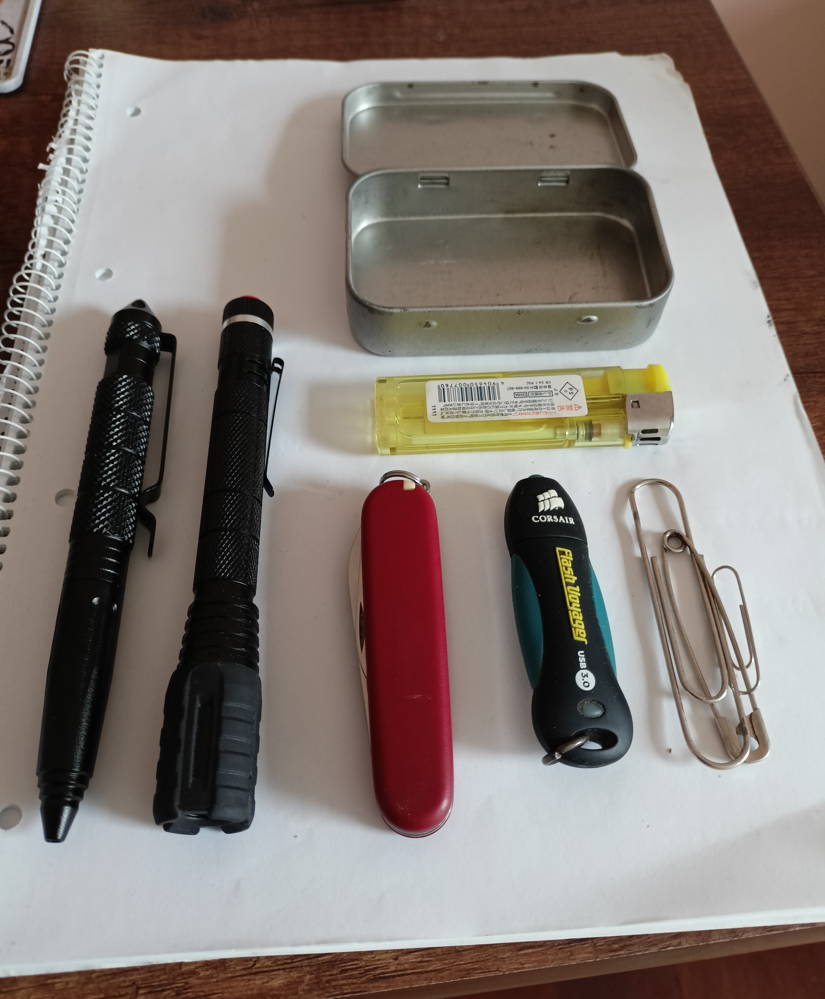
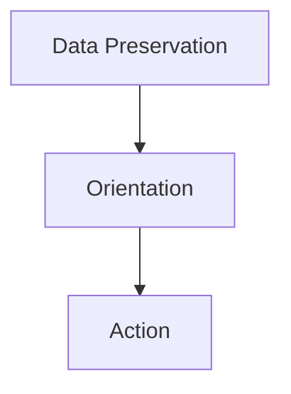

+++
title = "The Digital Survival Drive: Building an Autonomous Cyber-EDC"
description = "How to build an autonomous digital survival USB drive with Ventoy, Tails, Kali Linux, VeraCrypt, offline maps and data recovery tools."
date = 2025-11-23
type = "article"
path = "the-digital-survival-drive-building-an-autonomous-cyber-edc"

[extra]
image = "images/EDC-USB.jpeg"

[taxonomies]
tags = ["security-and-privacy", "resilience-and-preparedness", "tutorial"]
+++


Carrying a knife, a light source, and a way to make fire is the baseline of physical preparedness - **Everyday Carry (EDC)**. Everything else depends on the context and the terrain: a medkit and compass for the wilderness, extra water for the desert, thermal gear for the poles.

But the 21st century has introduced a new domain with specific, often brutal demands: **cyberspace**. Data loss, internet censorship, grid failures, or the sudden necessity to operate on untrusted, foreign hardware are not hypothetical doomsday scenarios; they are real operational risks. We should be as prepared for them as we are for a power outage or a flat tire.

This motivated my latest project: a specialized EDC USB drive designed for **Digital Survival**. This concept isn’t about having a "flash drive for files". My goal was to create an **autonomous operational unit**. It is the digital equivalent of a field workshop, a medkit, and a secure vault, all compact enough to fit on a keychain, inconspicuous, yet fully capable.

## I. The Three Pillars of Digital Survival
When designing this tool, I didn’t ask, "What can I download?" I applied the **PACE** planning methodology (Primary, Alternate, Contingency, Emergency) and the principle of **Separation of Concerns**. The entire system rests on three strategic pillars:

### 1. 🛡️ Identity & Protection (Passive Defense)
Just as I protect my physical body, I must protect my personal and sensitive data.

**The Concept:** If I lose this drive or it gets confiscated, it must not mean "game over." Data must be strictly separated into "Public" (non-critical, deniable) and "Critical / Private" (for my eyes only).

**The Solution:** Strong encryption with plausible deniability. All documents, passwords, and ID scans reside in a sealed encrypted container. The rest of the drive is a "grey zone."

### 2. 🧠 Knowledge & Orientation (Offline Independence)
Relying on the Cloud or Google in a crisis is a gamble. The Cloud is just someone else’s computer that you might not be able to reach.

**The Concept:** What I carry with me is what I know. I need to locate water sources, treat an injury, or repair an engine, even in total "digital darkness."

**The Solution:** A local library. Vector maps with topography (terrain, not just roads), medical manuals, and technical documentation. All in open, robust formats (PDF, Map) readable on any machine.

### 3. ⚔️ Capability & Action (Active Tools)
Passive backups are like canned food in a cellar. They keep you alive, but they don’t solve the situation; they only buy time. I need tools - the ability to act, change, and influence my environment.

**The Concept:** Any computer I approach is just "dead metal" (hardware). I bring the "soul" (software and know-how). I must be able to analyze an unknown network, write an automation script, recover data from a corrupted drive, or communicate anonymously.

**The Solution:** A portable development environment (Python), network scanners, and recovery utilities that run instantly without installation.

```text
The order of steps (detailed description below):

- format your USB with Ventoy (1)
- move chosen OS (2)
- move your private encrypted files (3)
- move chosen active "live" tools (4-8)
- move your pasive "backup" tools & files (manuals, maps, e-books.. )
- finally create a README.md file

- make 2 identical EDC-USB
```

## II. The Anatomy of Choice: Tool Selection
Every program on this drive survived a rigorous selection process. Just because I can have something doesn’t mean I should. The criteria were absolute: **Minimalism, Simplicity, Robustness, and Cross-Platform Compatibility**.

### 1. Ventoy (The Foundation)
**Why:** Flexibility. Old methods of "burning" ISOs locked the USB to a single purpose. Ventoy allows the drive to function as standard storage while simultaneously booting multiple rescue systems. It is the most efficient use of space.

### 2. Kali Linux vs. Tails (Force vs. Stealth)
**Why two systems?** Because they serve opposing tactical goals. It’s a redundancy against failure.

**Tails** is silent, hidden, and amnesic. It is the "ghost" for situations requiring secure communication and disappearing without a trace.

**Kali** is loud, aggressive, and packed with tools. It is the active "mechanic" for repair, penetration, and reconnaissance.

**Detailed Operational Profiles (Tails and Kali)**
#### 👻 2.1. TAILS: Operation Mode "GHOST"
A completely isolated, anonymous operating system that runs solely in RAM. It ignores the host OS and leaves absolutely no trace (digital DNA) on the machine after the USB is removed.

##### 2.1.1. Capabilities & Limitations
**Connectivity:** All traffic is forced through Tor. Your IP and MAC address are masked by default.

**Amnesia:** Anything you create and do not explicitly save to an external drive or encrypted persistence volume disappears forever upon shutdown.

**Productivity:** Includes a full suite of tools (LibreOffice, GIMP, KeePassXC)—you can work, write, and create just as you would on a standard desktop.

##### 2.1.2. Interaction with the Host (Target) PC
Tails behaves differently depending on the machine you connect it to:

🪟 WINDOWS (Standard):

* Access: ✅ FULL. If the internal drive is not encrypted (BitLocker), Tails can mount it. You can view documents, photos, and system files.

* Use Case: Data rescue or extracting information without leaving forensic evidence.

🐧 LINUX (Standard - Ext4):

* Access: ✅ POSSIBLE (With Admin Password). Tails natively reads Linux filesystems. However, to mount internal drives with write access, you must set an Administration Password at the Tails welcome screen. Without it, Tails often mounts internal drives as read-only for security.

🪟 WINDOWS (BitLocker) / 🐧 LINUX (LUKS):

* Access: 🔒 LOCKED. You can see the drive partition, but without the decryption key/password, the data is inaccessible noise

🍏 MACOS (Modern):

* Access: 🔒 FORTRESS. Due to FileVault encryption and the APFS filesystem, accessing data on a modern Mac’s internal drive is virtually impossible.

* Boot: On newer Macs (Apple Silicon M1/M2/M3), standard Tails builds will not boot due to the different processor architecture (ARM).

#### ⚔️ 2.2. KALI LINUX: Operation Mode "SWORD"
An offensive operating system running with full root privileges. It is designed for breaking, fixing, diagnosing, and dominating hardware. On a network, it is "loud" and visible (not anonymous by default).

##### 2.2.1. Capabilities & Limitations
**Unlimited Power:** You have absolute control over the hardware (Wi-Fi cards, drives, ports), bypassing Windows permissions entirely.

**Visibility:** Your traffic is visible to network administrators. Your IP address is real. It is not suitable for covert communication unless you manually configure Tor or VPNs.

**Persistence:** Unlike Tails, Kali does not aggressively wipe RAM on shutdown and can be configured to save changes.

##### 2.2.2. Interaction with the Host (Target) PC
🪟 WINDOWS (Standard):

* Access: ✅ TOTAL. Kali does not ask for the Windows user password. It mounts the drive, allowing you to copy, delete, or modify any file (including system files like System32 or registry hives).

🪟 ENCRYPTED DRIVES (BitLocker / FileVault):

* Access: 🔒 LOCKED. Without the key, the drive is sealed. However, you can create a bit-by-bit disk image of the encrypted partition for later brute-force attacks on a more powerful machine.

📡 NETWORKS (Wi-Fi):

* Capability: Can switch the Wi-Fi card into "Monitor Mode" (sniffing traffic) and perform packet injection attacks to crack Wi-Fi passwords. This is impossible in standard Windows without specialized drivers.

🐧 LINUX (Standard - Ext4/XFS/Btrfs):

* Access: ✅ TOTAL (ROOT). Kali runs as root (superuser). It ignores the file permission settings of the host system. Even if a folder is set to "private" (chmod 700), Kali opens it. You can reset root passwords (chroot), edit server configs, or extract SSH keys.

🍏 MACOS (Intel - No FileVault):

* Access: ⚠️ LIMITED / READ-ONLY. Apple uses the APFS filesystem. Modern Kali versions can usually read it (view/copy files), but writing to APFS is experimental, risky, or unsupported. Older Macs (HFS+) are fully accessible.

🍎 MACOS (Apple Silicon - M1, M2, M3…):

* Access: ⛔ CRITICAL FAILURE. The standard Kali ISO on your USB is for x64 (Intel/AMD) processors. Modern Macs use ARM chips. Your USB drive will not boot. Furthermore, booting from USB on Silicon Macs requires specific authorization in Recovery Mode. Do not waste time attempting this in a crisis.

### 3. VeraCrypt (The Vault)
**Why:** The balanced universal standard. BitLocker is Windows-only; FileVault is Apple-only. VeraCrypt runs on everything (Win/Lin/Mac). The file container `.hc` is easy to backup and transport.

### 4. Cruiser + OpenAndroMaps (The Map Room)
**Why not Google Maps?** Google’s offline maps are data-heavy and lack topography.

**Why Cruiser:** Vector maps of entire nations take up only megabytes. Cruiser with the ‘Elevate’ theme renders contour lines, path quality, and water sources. That is the difference between tourism and survival. Plus, it runs on Java - everywhere.

### 5. DMDE (Data Recovery)
**Why not Recuva or TestDisk?** Recuva is a toy. TestDisk is excellent, but CLI-only interfaces invite mistakes under stress.

**Why DMDE:** It offers a minimalist GUI, is fully portable, extremely lightweight, and works across all systems. It bridges the gap between power and usability.

### 6. The Python Ecosystem (VSCodium + MiniPython + Thonny)
**Why:** We live in a code-driven world. The ability to program is the modern literacy equivalent of reading and writing in the Middle Ages - it represents the power to actively solve problems. Python is the ideal "construction kit" for this.

**VSCodium:** A comfortable IDE stripped of telemetry.

**MiniPython:** A clean engine (official Python for embedded systems) that doesn’t depend on the host PC.

**Thonny:** The backup chute. If everything else fails, Thonny will run. Moreover, it bridges the gap to the physical world, allowing me to program hardware (IoT/ESP32) in the field.

### 7. Nmap (Network Intelligence)
**Why not Wireshark?** The Pareto Principle (80/20). Wireshark (packet analysis) is too granular and often blind in the age of HTTPS.
**Why Nmap:** It provides immediate situational awareness ("Who is on the network?", "Is that port open?"). It is faster and provides a clearer tactical picture.

### 8. The Essential Utilities (Quality of Life)
**Why:** In a crisis, friction is the enemy. You don’t want to fight the operating system just to open a manual or retrieve a password. These small, portable tools solve specific, critical friction points that standard Windows installations often fail to address.

**7-Zip (The Universal Key):** Windows struggles with non-standard archives like .tar.gz or .rar. 7-Zip handles everything. More importantly, it allows for quick, robust AES-256 encryption of files for transport without needing to mount the full VeraCrypt volume.

**Sumatra PDF (The Library Interface):** Why not Adobe? Because speed matters. Sumatra is instant and lightweight. Crucially, it supports .epub and .mobi formats, transforming the computer into a universal e-reader for the e-books and manuals.

**Scrcpy (The Hardware Bridge):** A smartphone with a broken screen usually becomes a useless brick, cutting you off from communication. Scrcpy allows you to view and control an Android phone via PC over USB. It turns a hardware disaster into a manageable inconvenience.

**KeePassXC (The Keyring):** Human memory is fallible under stress. Relying on it for complex passwords is a single point of failure. KeePassXC manages the keys to your digital life in an offline, encrypted database that is cross-compatible with the Tails OS instance on this very drive.

## Logistics Note: The Cost of Independence
It is important to emphasize that **every software tool listed here is completely free (for personal use)**. You do not need a budget for licenses. The barrier to entry is not financial; it is intellectual. The true investment is your time, research, and the discipline to execute the plan.

The only monetary cost is the vessel itself - the USB drive. Treat it as essential gear, not office supply. Choose a rugged, high-quality unit (metal or rubberized casing) capable of surviving physical stress, moisture, and dust; with a good capacity - in my opinion 32 GB is a bare minimum and anything between 64 - 128 GB should be perfect. The software costs nothing, but the capability it provides is priceless.

An example of my EDC kit with Cyber-EDC in it


## Operational Strategy: Modes of Use & Redundancy
Your EDC-USB operates in two distinct modes: **Active** (booting the OS directly) or **Passive** (accessing stored files and portable apps on a host computer).
Crucially, you cannot do both simultaneously; you cannot boot the OS from the drive AND access its separate data partition as an external source at the same time.
Therefore, the optimal strategy is to build **two identical EDC-USB drives**. This serves a dual purpose:

**Tactical Flexibility:** You can boot a secure OS (e.g., Tails or Kali) from the primary drive and mount the secondary drive to access your documents, encrypted vaults, or portable tools.

**Redundancy:** Following the rule "Two is one, and one is none," the second drive acts as a critical hardware backup in case of loss, corruption, or physical damage.


## III. The Cognitive Anchor: `README_EMERGENCY.md`
In a crisis - whether due to time pressure, fatigue, stress, or a hostile environment—humans suffer from "tunnel vision." Memory and cognitive functions degrade. We need compensation. The `README_EMERGENCY.md` file is not just "documentation." It is an **operational checklist**. It is designed to replace memory when you need to focus your brainpower on solving the problem, not on remembering how to operate a tool.

### 1. Key features for orientation under pressure:
**Universal Readability:** Markdown (`.md`) ensures legibility in Notepad on Windows 98, a Linux terminal (`cat`), or a modern IDE.

**"Action-Reaction" Structure:** No theory. Only direct instructions: "To do X -> Run file Y -> Click here."

**Cross-Platform Routing:** Immediately directs you to the correct executable (Win/Lin/Mac) so you don’t waste time testing incompatible files.

**Safety Breaker:** The very first lines remind you of critical protocols (Dismount VeraCrypt) that might be forgotten in haste, preventing data corruption. This file is the difference between "having the tools" and "having immediate operational capability."

### 2. The Blueprint: Designing the README_EMERGENCY.md
To ensure the file serves its purpose as a cognitive anchor, it should have a logic structure. Here is the template for building your own.

#### 2.1. The Tactical Skeleton (Logical Flow)
Do not organize alphabetically. Organize by priority of survival:



A. ⚠️ CRITICAL SAFETY PROTOCOLS (Top Priority) 

Before the user executes a single command, they must know what not to do to avoid catastrophe.

**Data Corruption:** Explicit instructions on when it is safe to remove the drive (Dismounting VeraCrypt volumes).

**OPSEC:** What to do if confiscation or compromise is imminent.

B. 🗺️ TERRAIN MAP (Directory Tree) 

A visual map of the drive. In high-stress situations, browsing through folders blindly wastes time.

**Display:** Where the Intel (Knowledge) is stored, where the Tools are, and where the Boot Images reside.

C. 🖥️ BOOT SYSTEMS (Independent OS) 

For situations where you need to bypass the host OS entirely.

Structure per System:

**Name:** (e.g., Tails, Kali).

**Purpose:** One sentence (e.g., "For total anonymity" or "For offensive repair").

**Deployment Trigger:** When to use it (e.g., "Use when the host PC is untrusted or infected").

D. 🛠️ LIVE TOOLS (Cross-Platform Arsenal) 

The largest section. Group tools by Mission Profile, not by name.

**Sector 1:** VAULT & ACCESS (VeraCrypt, KeePass) - *How do I access my documents?*

**Sector 2:** RECOVERY & REPAIR (DMDE, TestDisk) - *How do I salvage deleted files?*

**Sector 3:** RECON & NETWORK (Nmap, Wireshark) - *Who else is on this network?*

**Sector 4:** INTEL LIBRARY (Maps, PDFs) - *How do I open the topo map without internet?*

For each tool include:

**Path to Executable:** Clear location for Windows (.exe), Linux (binary), and Mac (.app).

**Kick-start Guide:** A simplified "Click here -> Select this -> Done" instruction.

E. 🚑 TROUBLESHOOTING (Field Repair) 

A list of things that will inevitably go wrong when you need them most.

**Boot Failures:** What to do if the PC ignores the USB (Secure Boot settings).

**Permission Errors:** How to handle chmod +x on Linux or Gatekeeper on Mac.

**Hardware Issues:** What if the network card isn’t detected? (Driver fallbacks).

---
Cyber EDC Structure:
```text
[USB ROOT] 
│ 
├── README_EMERGENCY.md (Cognitive Anchor: Stress protocols) 
├── secure_vault.hc (The Vault: Encrypted data & ID) 
├── kali-linux.iso (The Sword: Bootable OS for offense/repair) 
├── tails.img (The Ghost: Bootable OS for anonymity) 
│ 
├── _KNOWLEDGE/ (PASSIVE: The Library) 
│ ├── Books/ (PDF, ePUB..)  
│ ├── Manuals/ (PDF: Medical, Survival, Chem, Docs) 
│ └── Maps/ (Offline Topo Maps + Cruiser App) 
│ 
└── _TOOLS/ (ACTIVE: The Workshop) 
  ├── VeraCrypt/ (Key to the Vault - Win/Lin/Mac) 
  ├── DataRecovery/ (DMDE for all systems) 
  ├── Mobile/ (Scrcpy) 
  ├── Networking/ (Nmap Scanner) 
  ├── Privacy/ (Tor Browser) 
  ├── Security/ (KeyPassXC) 
  ├── Utilities/ (7-zip, SumatraPDF) 
  │ 
  ├── VSCodium/ (Primary IDE) 
  ├── Thonny/ (Backup Editor & HW Hacking) 
  ├── _MiniPython/ (Independent Python Engine) 
  └── _my_scripts/ (Custom automation tools)
```

## The Output: Operational Readiness
This EDC-USB is not a "warez dump." It is a system for a person who intends to be **an actor, not a victim**.

It allows me to walk up to any random computer in the world and, within one minute, transform it into:

* A secure communications station.
* A software development studio.
* A diagnostic and recovery terminal.
* A navigation command center.

This is the definition of modern digital preparedness.

## IV. The Proving Ground: Field Verification
A tool you haven’t personally tested is a liability, not an asset. Just as you must practice starting a fire with emergency tools (ferro rod, matches, lens) in calm conditions before a storm hits, you must drill with your digital EDC. This practice is what separates a theoretical plan from functional capability when you really need it.

### The Validation Checklist:
**The Boot Test:** Restart a computer and force a boot from the USB. Verify that the Ventoy menu loads and successfully launch both Kali and Tails to the desktop.

**The Portable Tool Check:** On a running host OS, execute the applications from the _TOOLS folder (VSCodium, Nmap, VeraCrypt) to ensure they launch immediately without installation.

**The Vault Drill:** Practice mounting and dismounting the secure_vault.hc container. Ensure you can access the files inside and lock them down quickly.

## Summary
Much more valuable than the physical EDC-USB drive itself (actually a pair) was the intellectual work required to build it: defining **what** a digital EDC should contain, **why** it exists, and **how** (in what scenarios) I intend to use it. Once I defined these strategic goals, selecting the specific tools was the easy part.

—

*With this in mind, use this framework to craft a variation that reflects your personal reality - taking into account your specific environment, resources, and goals.*