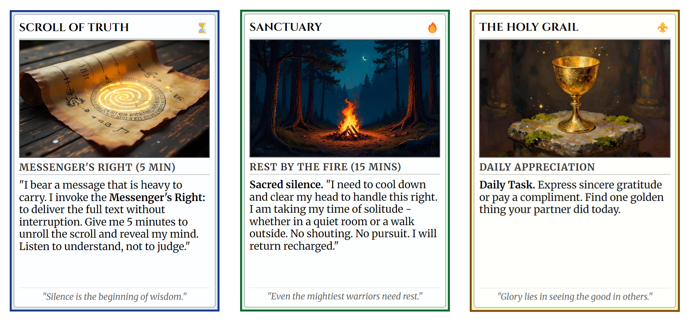
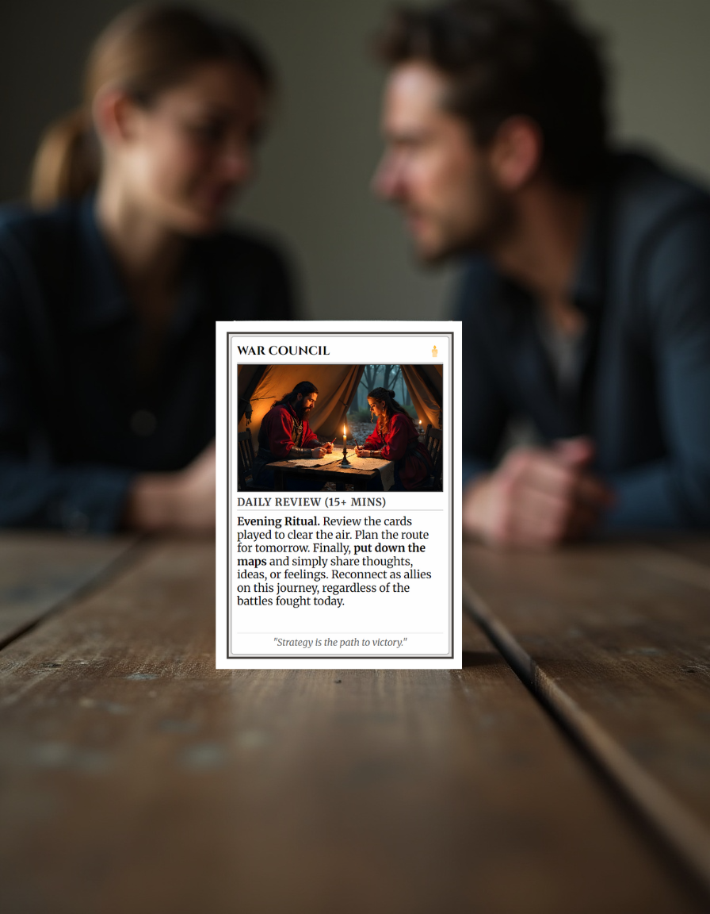
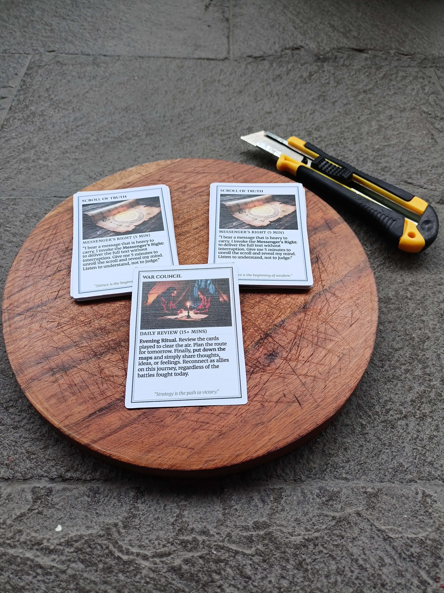

+++
title = "Protocol for Two: Building a Tactical Relationship System in a 4-Day Sprint"
description = "A case study of building and launching a relationship card-deck product in four days with AI, WordPress and a lean maker stack."
date = 2025-12-19
type = "article"
path = "protocol-for-two-building-a-tactical-relationship-system-in-a-4-day-sprint"

[extra]
image = "images/partner-pact-deck.png"

[taxonomies]
tags = ["web-development", "ai-assisted-development", "digital-products", "tutorial"]
+++

*How I applied survival principles and a rapid dev stack to clear the "Fog of War" in my own marriage - and turned it into a global product.*

 
## I. The Origin: Clearing the Fog of War
It started as a personal necessity. I wanted to improve communication with my wife. I was tired of the loops of misunderstanding - the exhausting friction where intentions get lost in translation. I wanted to bring playfulness, perspective, and genuine partnership back into the mix. I didn’t want to argue against each other; I wanted us to solve problems together and be able to understand each other better.

I approached this emotional problem the same way I approach survival or coding:

* Strip away the unnecessary
* Focus on function
* Build what lasts

I combined my passion for board games and history with a "straight-to-the-point" mindset. The result was a playable prototype - a deck of cards designed to act as a clear, undeniable interface for our needs.

Unlike words, a card is tangible. It is physical. It cannot be misheard or reinterpreted or have a "tone". When played - it says exactly what it means.

* Instead of snapping "leave me alone," I play **SANCTUARY**. It’s not a rejection; it’s a signal that I need some time and space to recharge and don’t get overwhelmed.
* Instead of nagging about chores, we play **QUEST**. It turns every task into a interesting mission.
* When we want to plan, we summon the **WAR COUNCIL**.

It worked. The "gamification" of our partnership removed the ego from the equation. Even mundane issues became an adventure. *We stopped fighting the noise and started honoring the alliance and enjoying the ride with this new way of communication.*

## II. The Decision: From Prototype to Product
I had a system that worked. I was the "Customer Zero," and the beta test in my own living room was a success. Looking at the market, I saw a gap. Existing tools were either focused purely on intimacy or overly heavy on deep "therapy talk."

There was nothing for the pragmatist. Nothing for the couple that wants a **tactical interface**.

So, I decided to test my idea and deploy it globally. 

**My goal:** Develop a downloadable, print-ready product that anyone can fabricate at home and use immediately. I gave myself a strict timeline.

*"A 4-day sprint."*

## III. The Build: The "Maker" Stack
Just like in software engineering, I started from the bottom - the product logic. I knew what I wanted to achieve, but I needed the infrastructure to deliver it. I chose AI @Gemini as my project assistent and co-pilot.

Here is the operational breakdown of the sprint:

### 1. Visuals & Prototyping
I refined the visual language of the cards using @Freepik(now @Magnific). I needed a look that was clean, modern, and with the right atmosphere - not cartoony.

### 2. The Digital HQ (Web & Domain)
Without owned territory, you are just a tenant on social media. I secured the domain via @Web4U and set up hosting on @10Web to leverage their managed @WordPress capabilities. As a cherry on the top - a web favicon with @Favicon.io.

* **The Process:** Using AI, I rapid-prototyped the Landing Page and legal documents (Terms & Conditions). We defined the "Brand Voice" - stoic, direct, supportive - early on. This saved hours of decision fatigue later.
* **The Code:** While AI handled the heavy lifting, my knowledge of HTML/CSS was useful. It allowed me to work and understand the design more so I could communicate my vision better and change details to my liking.

### 3. The Global Interface (Localization)
Since I am based in Peru but aiming for a wider reach, a single language was not enough. I implemented @Polylang to manage English and Spanish versions of the site. It’s a clean, lightweight WordPress plugin that effectively doubles the potential market impact without doubling the maintenance workload. I can also easily scale up and add more languages in the future.

### 4. The Communications Obstacle
A small but telling detail of digital nomad life: I needed a dedicated support email. Originally, I planned for Gmail. However, located in Peru with only a foreign (Czech) SIM card, I hit a wall of automated bot verifications.

* **The Pivot:** I capitulated on Google and switched to @Proton.me. It was set up in seconds, is far more secure, and respects privacy. A survivalist choice in the digital realm.

### 5. The Visual Asset Pipeline
To sell a digital product, people need to see it in the real world. I used @Canva and @Freepik to generate high-quality mockups, tweaking details until the digital file looked like a physical product on a shelf.

### 6. Commerce & Logistics
To complete the pipeline, I needed to accept payments.

* **The Cart:** I chose @SureCart, a robust and free WordPress plugin. It handled the digital file delivery logic perfectly.
* **The Bank:** @Stripe was the obvious choice for payment processing - reliable, multi-currency, and easy to integrate.
 
## IV. The Bridge: Bringing it to Reality
The final step was the most satisfying. I needed to prove the concept physically.

I took my own files to a local copy center here in Lima. I selected the paper stock (integrating the paper choice into the instruction manual), printed the sheets, and sat down to cut the cards.

I photographed the result with my mobile phone on my work desk. No studio lighting, no fake polish. Just the raw atmosphere of a deployed system. This grounding in reality is essential - from a PDF on a screen into your hand.

## V. The Output: Operational Readiness
In 4 days, I went from a personal idea to a fully automated, globally available digital product with minimal overhead costs.

I utilized my full skill stack: programming logic, AI prompting, web design, and a survivalist mindset. I solved a "problem" (partner communication & understanding) with a system that works and is actually fun to use.

**The Partner Pact  project is now live.** It’s not just a product; it’s a living proof to what is possible when you combine a clear vision with the discipline to execute.

—

*"The Partner Pact - System Engineered for Relationship Resilience."*

Link to Project:  [ThePartnerPact.com](https://thepartnerpact.com/)