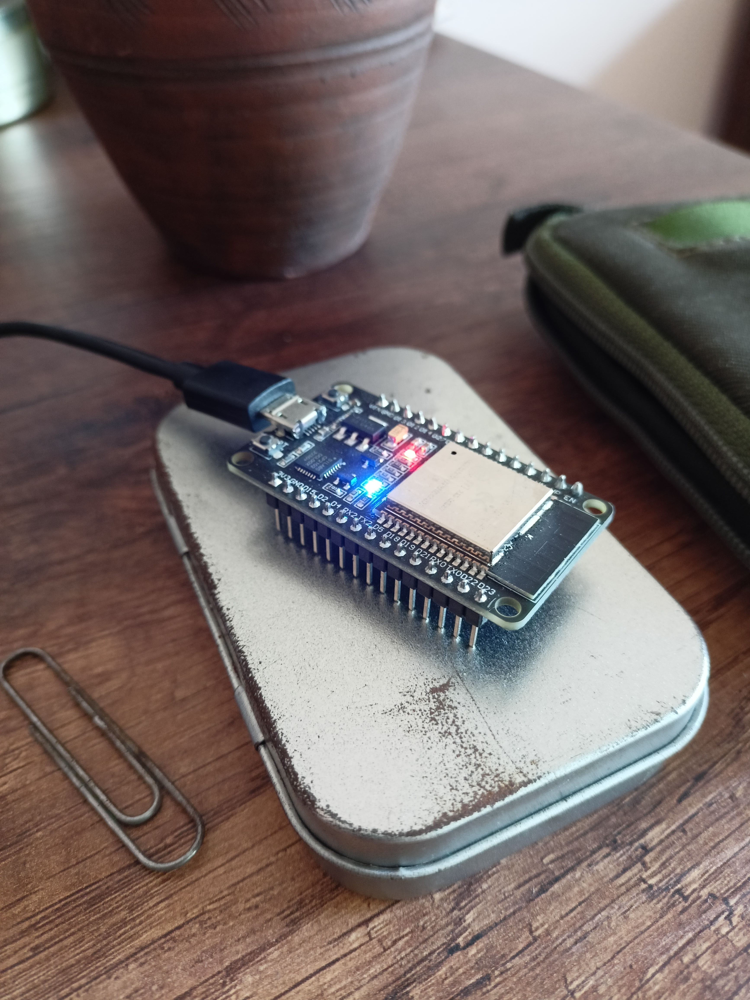
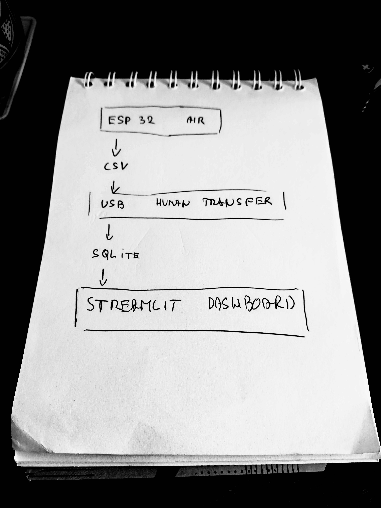
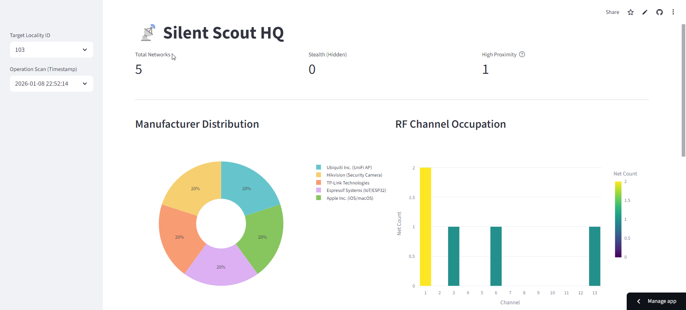
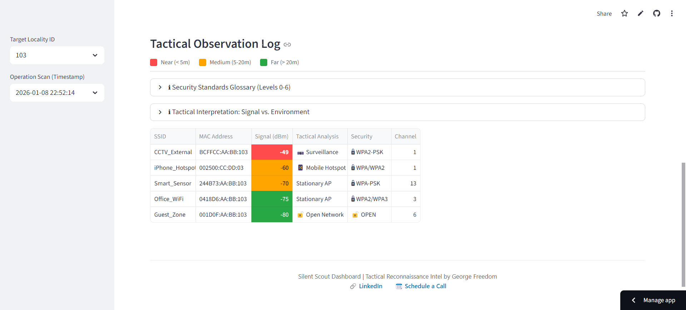

+++
title = "The Silent Scout: Building a Low-Profile Digital Resilience Tool"
description = "How to build a cheap, expendable field-monitoring tool from ESP32 firmware and a Python dashboard, with the design reasoning behind it."
date = 2026-01-09
type = "article"
path = "the-silent-scout-building-a-low-profile-digital-resilience-tool"

[extra]
image = "images/silent-scout.jpeg"

[taxonomies]
tags = ["security-and-privacy", "tutorial", "resilience-and-preparedness"]
+++

## Introduction
Warfare has evolved. It is no longer just about building a larger air force or having the heaviest artillery systems. Today, it is about having a well-balanced "deck" - to use a card game analogy - tailored to local conditions and capabilities. It requires careful composition, maintenance, and development. And crucially, it requires not just repeating what has been done, but creating something new.

Yet, the logic remains the same. The economics cannot be cheated or ignored. If my defensive systems are orders of magnitude more expensive or complex to produce than an adversary’s attacking tools, I might resist in the short term, but I will inevitably lose in the long run.

*However, this reality extends far beyond the traditional battlefield.*

A security strategy focused solely on high-tech, always-online infrastructure fails the moment you step off the grid. Whether managing a **remote expedition**, securing a **physical perimeter** in a chaotic urban environment, or monitoring critical assets **in the field**, the blind spot remains the same. Standard systems often lack the granularity to detect low-profile threats - digital noise, unauthorized devices, or subtle intrusions. To ignore these "micro-signals" because they seem trivial is a critical error. These methods work. Therefore, **autonomous field monitoring** must become an equal part of our preparation.

My interest in this overlooked area (read about my [Cyber-EDC project](/the-digital-survival-drive-building-an-autonomous-cyber-edc)) led me to the **"Silent Scout" project**. Here, I combined a specific mindset - focusing on low-profile operations, cost-efficiency, and user simplicity - with my technical knowledge of hardware/IoT (ESP32 microcontroller) and the Python ecosystem (MicroPython, Pandas, Streamlit).
 
## PART I: The Concept
### 1.1 The Objective: Situational Awareness
The goal of the project was to create an unobtrusive, personal WiFi scanner. The minimum viable output is to determine whether a given location is "clean" or occupied in terms of network coverage.

*Note: Silent Scout operates on the 2.4 GHz ISM band. While modern Wi-Fi 5/6 utilizes 5 GHz or 6 GHz, the 2.4 GHz band remains the industry standard for long-range signal propagation and IoT/Surveillance infrastructure (CCTV, doorbells, smart locks).*

Subsequently, a detailed analysis of the captured data is performed to identify individual networks by manufacturer and device type (home networks, surveillance cameras, printers, or other hardware), their security levels, signal strength (proximity), and frequency band saturation. The results of this analysis are then visualized on a dedicated dashboard.

### 1.2 The Core Philosophy: Expendability & Minimalism
The purpose was not to build the "ultimate" WiFi scanner. The primary mindset is strategic: How to use simple, easily accessible, **replaceable** - or even expendable - technology to build usable tools for specific tasks?

The goal is to minimize bias and security risks. Everything is subordinate to this rule: austerity, minimalism, and a combination of **"smart"** solutions (automated scanning) and **"dumb"** processes (manual data retrieval, no automated evaluation).

### 1.3 Operational Logic: The "Dead Metal" Protocol
Emphasis is placed on the clarity of individual processes with the minimum necessary level of automation. I need to know exactly where errors or problems can occur = I anticipate them.

The scanner itself (a basic ESP32 microcontroller - read [my article](/ignition-sequence-how-to-flash-micropython-onto-your-esp32)) is expendable. Communication with the scanner during data collection is strictly visual via a single LED - no typing or confirmation required. The scan is triggered by a simple physical button.

ESP32 - scanning in progress ..

Crucially, I do not encrypt the scan results on the device. Why? because without the "Key"-the knowledge of where and when the scanning took place-the data is useless. This key is held only in the scout’s head or kept separate from the device (Separation of Concerns).

In the interest of maintaining a **low profile**, the device remains in a state of **"dead metal"** most of the time, active only for the few seconds required to collect data. Results are not transmitted automatically to a central server. They remain physically on the device. To retrieve the intel, one must physically carry the unit to HQ (or at least a secure computer) and manually transfer the file.

Subsequently, a script injects the data into a central database. Selected information is visualized and highlighted, but the interpretation remains strictly in human hands - there is no "automated evaluation" that could introduce algorithmic bias. While low automation might sound like a weakness, it is the project’s greatest strength: I maintain absolute control over the chain of custody - what data I accept and when. (If operational needs change, this behavior can be easily modified to transmit data via a mobile hotspot).

### 1.4 The Software Stack: Python Universe
Another key decision: the programming language. Python was chosen intentionally. It is extremely easy to learn and understand. All code - especially the firmware on the microcontroller (MicroPython - read [my article](/micropython-bridging-the-digital-and-physical-worlds)) - is written with readability and field modifiability in mind.

You don’t need to be a senior programmer; basics are enough. For data transformation, I use the **Pandas** library, and for the final visualization of the findings, **Streamlit**. This ensures we stay entirely within the Python universe, simplifying the workflow.

### 1.5 Field Deployment & Expansion
The project is designed to be easily expanded or repurposed. Currently, I utilize only the built-in WiFi sensor, LED, and button. However, upgrade possibilities are broad - limited only by the chosen focus (e.g., specific scanning, logging, environmental measuring) and sensor quality.

For actual field reconnaissance, the **device needs some power source** (e.g. a power bank for a start or a small Li-Po battery for a slim profile or a combination of a Li-Po battery and a solar panel for total independence). For better operational awareness, a **simple graphic display** (e.g., LILYGO T-Display S3) can be added. To increase overall resilience against weather and humidity, the **device can be armored** - wrapped in heat-shrink tubing and sealed with a lighter or placed into a plastic box for extra protection. This creates a solution that can survive almost anything, costs a few dollars, and can be fabricated entirely in field conditions.

 
## PART II: The Architecture & Build Log
For this project, I chose the bottom-up approach I typically use for web applications. This means starting from the data, choosing the necessary processing technologies based on that data, and gradually moving up to analysis and visualization.

Build Log Workflow

### 2.1 The Agent: ESP32 Firmware
When programming the microcontroller, I applied basic **SoC** (Separation of Concerns) principles for configuration and modularity. Operations are divided into simple functions grouped by focus (hardware.py, logic.py). These functions are then utilized in the main application file (main.py), where the scanning process is triggered by user interaction (button press).

User communication is handled via LED signaling (e.g., waiting for input, scanning in progress, data saved successfully). If a display is used, detailed text reports on ongoing operations are available. All networks detected within a single measurement are assigned a common "Location ID". This ID distinguishes individual datasets from one another.

The result is raw data saved into a CSV file in a separate folder (data). For manual maintenance, a script (cleanup.py) is available to wipe the CSV file and reset the Location ID, preparing the agent for the next mission.

### 2.2 The HQ: Workstation & Dashboard
In the project’s analytical and visualization center, I adhere to clear role distribution (configuration, analytics, visualization, static assets, input data, and database). The goal is a structure that is organized yet robust enough to allow for future development. However, the rule remains: 

*Clarity and readability take precedence over complexity.*

The first step is data acquisition (the CSV file). This must be saved into the corresponding project folder (/data/inbox). Running the ingest script (ingest.py) injects the data into the SQLite database (/data/database/scout.db). Data is either appended to existing records, or a new DB is created. Additionally, a timestamp column is added to log when the record was uploaded. Data is thus differentiated by location, and locations are differentiated by the upload date.

I retrieve and transform data from the database using Pandas for use in the overview and graphical elements of the Streamlit application (files analyser.py, vizualiser.py, and helper functions in utils.py). The application itself is encapsulated in a function within app.py, where its final structure and layout are assembled. Running this function launches the dashboard. This design also facilitates **easy deployment to the web (Streamlit Community Cloud)**.

Streamlit HQ - Dashboard:

Streamlit Log:

### 2.3 The Cost of Automation (And Why I Cut It Out)
The original version of the project included a third component - a Server. Specifically, a custom **REST API** (Flask) for automatic synchronization of data from the field.

**The idea was simple:** when the device was turned on, it would auto-detect if it was within range of my home WiFi. If yes, it would automatically upload the data (CSV file) to a specific API route. Upon receipt, the results were immediately loaded into the DB.

This was fast, clear, and convenient. 

*However, from a security perspective, it was a critical failure.*

To function, the ESP microcontroller had to contain login credentials for my home WiFi network (HQ) and access tokens for the server upload. This created a vector where a lost or stolen device could be exploited or cloned to gain access to data and the network itself. This opened the door for injecting false data (or malware), or generally allowing unauthorized access to the server, compromising the database and future analyses.

The initial solution was to encrypt data on the ESP32 and secure the API communication. But these solutions brought their own problems. **Encryption and verification** also increased the demand on the microcontroller’s performance and memory management. Handling multiple concurrent operations required implementing parallel processes (threading), further complicating the device.

At one point, **I realized I was spending a disproportionate amount of time and resources solving problems related only to marginal functionality**. I was paying a high price (security risk, unnecessary complexity) for a small benefit (automation). 

*What makes sense for a standard data collection app is unsuitable for a reconnaissance device intended to be low-profile, anonymous, and secure.*

After clarifying my priorities, I cut my losses and removed this entire section. By discarding the "smart" features, I eliminated a vast amount of operations (authentication, login, encryption), reduced the memory load, and could once again focus on pure, basic functionality and a reasonable level of security.

## Conclusion: The Human Element
The result is a transparent, clean, and cost-effective tool specialized for a specific purpose. It is "readable" and easily modifiable, consisting of two parts: the **Field Agent** (programmed ESP32) and the **Central HQ** (Streamlit app on a PC).

* The Agent serves a single purpose-local collection and storage of information.
* The HQ handles central collection and visualization to support decision-making.

The parts are independent; the Agent is expendable and easily replaceable. Most importantly, the interpretation of results is not performed by a "machine" but is left to the human operator. The acquired data is merely visualized clearly. Decisions must be based on both the currently observed data and experience. The final responsibility for the decision - and its consequences - always rests with the human.

—

➡️ Get inspired:

* Link to deployed [demo app](https://silent-scout.streamlit.app/)
* Link to [GitHub repo](https://github.com/GeorgeFreedomTech/Silent-Scout)