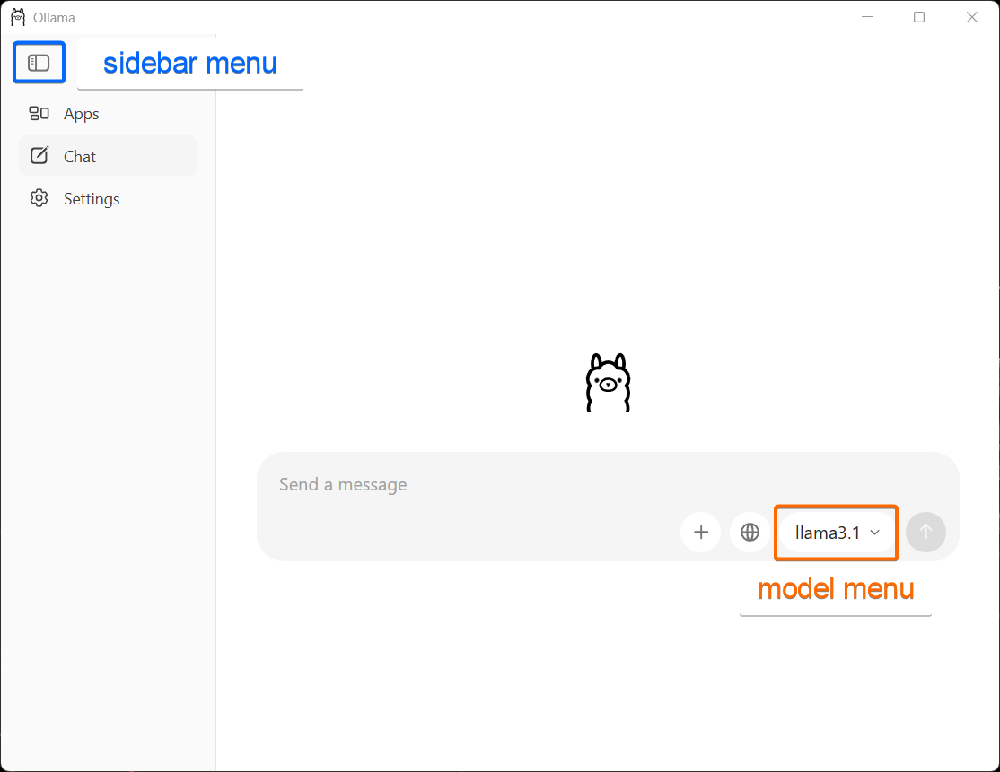
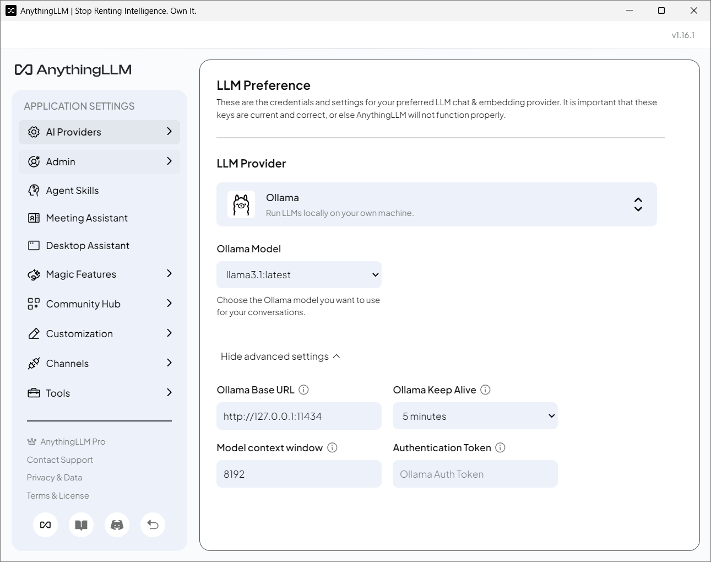
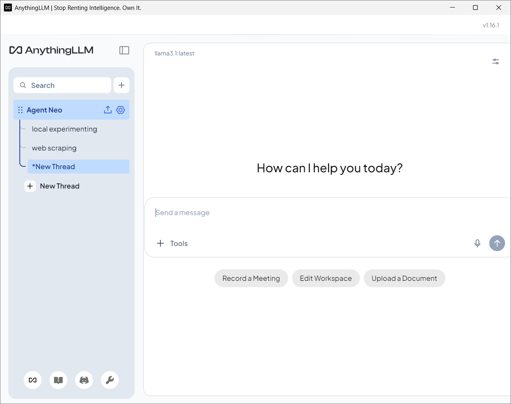
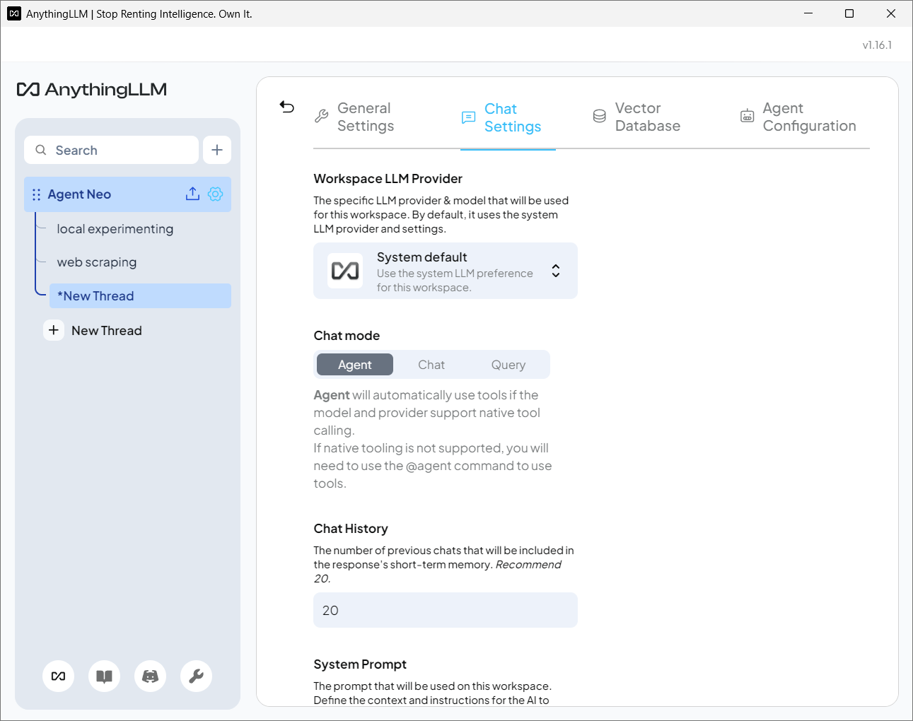
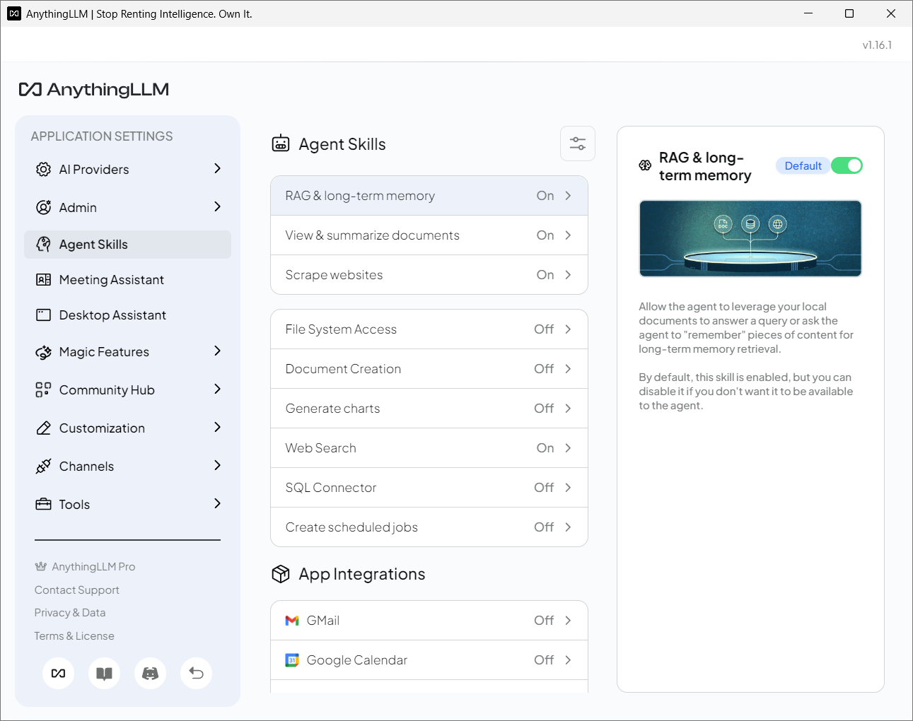
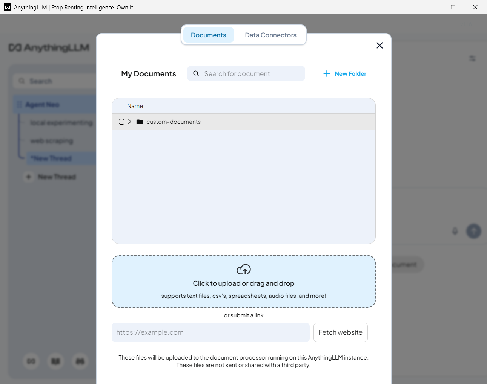
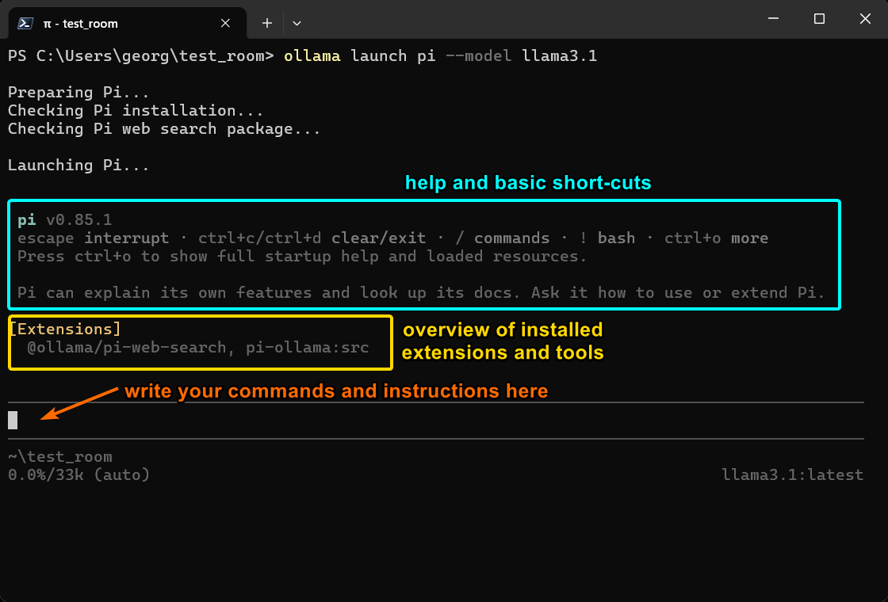
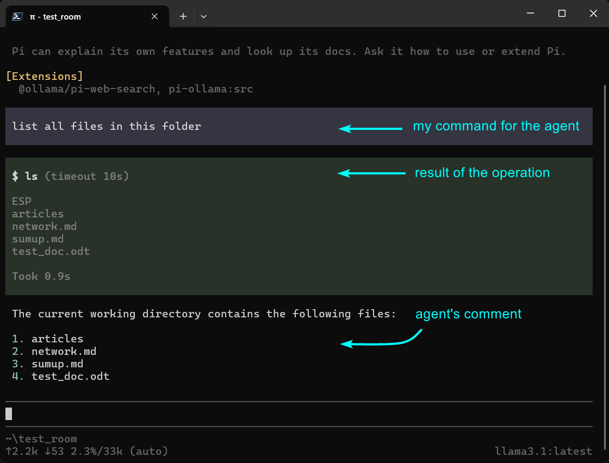
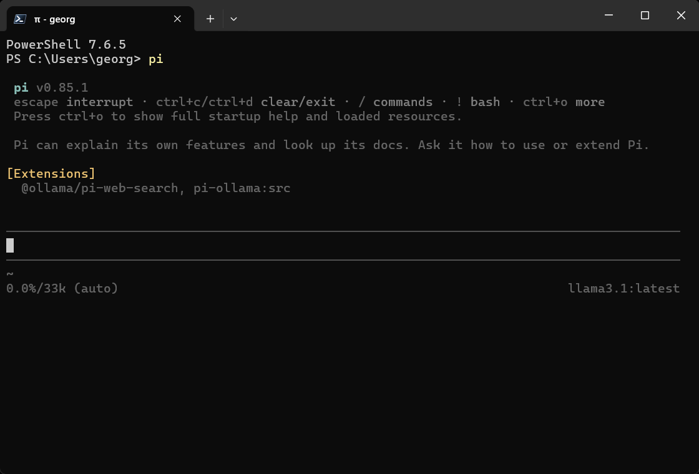

+++
title = "Local AI: A Practical Guide for Digital Rangers"
description = "A practical guide to running LLMs locally with Ollama, adding your own documents via RAG, and understanding how autonomous agents work."
date = 2026-09-11
type = "article"
path = "local-ai-a-practical-guide-for-digital-rangers"

[extra]
image = "images/Local-AI.jpeg"

[taxonomies]
tags = ["local-ai", "resilience-and-preparedness", "tutorial"]
+++


## A Head-First Introduction
We live in a digital age. Like it or not, we have to deal with it. That means knowing digital tools and understanding how they actually work - it’s time to look at how we can practically use artificial intelligence (AI) in our daily work. And do it without depending on big corps. Any idiot can use AI on the internet (Gemini, ChatGPT…) today. We will learn how to use and control our own **AI/LLMs** on a home computer = **local use**. Thanks to this, not only will we be independent of an internet connection and corporate services, but we will also take back control of our data, plus we won’t have to pay monthly fees for using AI. Our only cost will be our time and a bit of electricity for our machine. Of course, we will also look at **agents** … and learn how to use them, understand what they actually "are," and find out what they are good for and when it makes sense to use them.

*Note: All tools, models and agents used in this guide are 100% FREE.*

Let’s waste no time - grab a coffee and let’s get into it!

### Mission:
* install and use AI LLM locally on our computer
* how to use our own data with RAG
* create and use simple AI agents

### Operational Minimum (Terminology):

**token:** the basic building block for the model = a piece of text, or a part of a word.

**context window:** the total volume of text (the whole conversation) the model can hold in its "memory."

**System Prompt:** instructions for the model or agent, defining e.g., behavior and response style.

**model:** or LLM (Large Language Model), acts as a text generator (based on probability).

**quantization:** reduces the RAM/VRAM requirements of the model so it can be used even on a laptop.

**agent:** uses the "model" and additionally has specific access, permissions, and a set of tools (web access, file creation, access to local folders…).

**tool calling:** the model’s ability to recognize that it needs an external tool for a task and to prepare a request for the agent to use it (e.g., reading a disk, running a command).

**UI / GUI:** user / graphical interface for more convenient work (e.g., chat windows and other wrappers).

**RAG (Retrieval-Augmented Generation):** generally connecting the model with "my" documents and files so the model can use them.

**embedding:** converting text into numerical vectors (used for RAG), allowing searches in documents by "meaning" rather than just keywords.

 
## Phase 1: The Core System (Engine & Models)
### 1.1. Infrastructure: Choosing a Local Server
An environment for running and using various models on a computer or laptop. It is essentially a "local server" and manager for the models used, while also providing a basic user interface for usage and communication.

**Possible engine options:**
* **LM Studio:** The easiest all-in-one choice for Windows. It has a built-in model search engine, clear memory settings, and a clean design.
* **Jan.ai:** A fully open-source alternative to LM Studio, very lightweight and fast.
* **Ollama:** A runtime environment for the AI model that allows a modular approach (Ollama in the background + option for a custom UI or connection to programming scripts).

For our purposes, with an emphasis on universal and modular use, Ollama is the ideal choice - we will download and install it from:

* [Ollama website](https://ollama.com/)

### 1.2. The Brain of the Operation: Choosing and Deploying Models
The **model** represents the actual "brain" of it all. Some models are trained and focused more on general conversation, others on programming or deep thinking, some have a large context window, etc.

Common models or **LLMs** are for example Gemini, ChatGPT and Athropic. They are great but they are huge, require internet access and monthly subscription fee. For our cause (small independent private use) we will need a **"local model"** = a smaller model we can actually download and use on our machine. A model that doesn’t depend on internet connection and that is for free.

For basic work and building understanding, it makes sense to choose 2-3 models based on our needs. A good combination that covers most common situations and needs is a fast lightweight general model and a model for deeper reasoning.

**An example of a two-model "stack":**
* **llama3.1:8b:** a universal general model, ideal for queries, writing shorter texts and testing, working with files, and writing/checking code. Fast, a "workhorse," takes up about 5 GB.
* **deepseek-r1:8b:** for deep reasoning, we can follow the "chain-of-thought," more complex logic, ideal for structured checking, planning, and analytical work. Slower, an "architect," takes up about 5 GB.

Ollama - chat interface:


In Ollama, models can be downloaded and installed in two ways.

1. **Directly** in Ollama:
* open the Ollama app, click on the left - show the sidebar - select chat A conversation dialog box opens, and we can choose a model from the dropdown menu (in the text input window). Then we can start a normal question-and-answer conversation and change the model as needed.
In settings (left sidebar), we can make a few adjustments. I recommend at least increasing the context window size to 8K (8192) or 16K (16384) tokens.

2. Using the **Command Line**
* in the command prompt / PowerShell, we ask for a specific model - e.g.:

```bash
ollama run llama3.1
```

We can choose any model - if it’s on the disk, Ollama will run it; if not, it will download it first and then run it. Once running, we can (still in the command line) start a normal Q&A conversation. If we want to end the conversation or switch to another model, we type:

```bash
/bye
```

Now we can run another model using "ollama run," or decide we’re done for today and go do something else.

### 1.3. Summary: Ollama Runtime Environment
At this point, we have a **fully local AI** - completely independent of the internet. All data and all conversations are under our control. Nothing is sent, processed, or stored on remote servers. Data is stored purely locally = on our computer. Plus, everything is free, we pay no monthly fees, and we don’t have to watch our token count in a conversation. We have no limits and can use the model for as long as we want. We only pay for electricity. And that’s a damn good feeling.

 
## Phase 2: Tactical Memory (RAG & Personal Data)
As mentioned big LLM models are cool, but the real power of local AI lies in the combination of security (we handle everything on our computer, nothing goes "out") and leveraging our own data. So we will use a smaller local model.  And data means files and the information inside them. After that we need to "get our data into the model". In other words, now we need RAG processing.

### 2.1. GUI Extensions That Can Handle RAG
There are a few options, e.g., Chatbox (Chatbox AI), AnythingLLM, Open WebUI… and others.

For our purposes, AnythingLLM is the perfect candidate. It can do local RAG, so we can "feed" it folders with Markdown files, PDFs, or text documents - we will download and install it from:

* [AnythingLLM website](https://anythingllm.com/)

### 2.2. Integration: Workspace Setup
First, we run Ollama and let it run in the background. Then we launch AnythingLLM and do the basic setup:

1. **LLM Provider:** select Ollama
2. **model:** select a model (e.g., llama3.1)
3. **context window:** I recommend increasing the size to 8K (8192)

AnythingLLM settings:


After opening the conversation window (chat), we set up our operational environment, the "workspace." These settings will then apply to all conversations within it. We go to "General appearance settings" and do the "chat settings." By default, every workspace is set to "chat" with permissions for RAG, viewing and summarizing provided documents, and downloading web pages.

AnythingLLM - basic chat interface:


AnythingLLM - workplace settings:


We essentially have two main options for **chat settings**:

**set to CHAT:**

* for general conversations
* System Prompt: how to talk, respond, etc. (rules of communication)
* LLM temperature: higher = more creative, lower = more deterministic, for conversation = 0.4-0.5

**set to AGENT:**

for more active use with higher privileges
* Tools: rights and permissions, what the agent is allowed to use (e.g., access to workspace documents, access to files on the computer, internet access)
* System Prompt: we define its "behavior" and the roles it should follow when using tools
* LLM temperature: higher = more creative, lower = more deterministic, for agent = 0.3-0.4
* we can further specify the number of tools and the scope (limits) of permissions and access for the agent in "Agent Skills."

AnythingLLM - agent skills configuration:


To use **RAG processing**, we upload our selected documents into the workspace. Once done, we can leverage the combined power of the model and our data and documents. The model thus has access to quality data and gains a more accurate context.

AnythingLLM - inserting documents for RAG:


*Note: when using AnythingLLM with local models, our engine (Ollama runtime with models) must always be running.*

### 2.3. Summary: Using AnythingLLM
Local AI (in this Ollama + AnythingLLM setup), thanks to RAG and a simple "agent" mode, works best as an expert researcher. AnythingLLM can process a variety of input data and file types:

* Markdown (.md)
* PDF: Handles text-based PDFs
* Word (.docx), PowerPoint (.pptx), etc.
* Plain text (.txt), CSV, JSON
* Files like .py, .js, .html, .css, .json

**basic agent:** primarily a helper tool for documents and RAG can browse the web, extract text from a document, run a simple script, and write an answer in the chat, limited by the model’s capabilities and tied to the chat interface

**ideal job:** we have a large amount of local texts, books, code, files, project notes, or documentation, and we need to go through them, cross-reference, synthesize, track down connections, and prepare a relevant answer with a link to the source not suited for quick everyday consultations or deep brainstorming

**what we get:** besides the actual answer, we get links to specific uploaded files and the exact passages (chunks) where the information came from

If we need to bring more power and capabilities than what local models can offer we can easily do so by choosing a different LLM provider than Ollama (e.g. Gemini, OpenAI etc.) and by using our API key. On the other hand the price will be the loss of control and privacy. Plus eventhough some API use is usually free, extensive use will cost money.

## Phase 3: Executive (Autonomous Agents in Action)
To start off, Ollama offers a number of different agents freely available to test and use in combination with models - and this level this is all we need. Some are better suited for computer tasks and running in a terminal, others for searching and fetching data from the internet, some for deep analytical work, and others are designed specifically for programming or as plugins for custom IDEs (e.g., as an extension for VS Code).

### 3.1. Anatomy of Agent Systems
#### What is an Agent?
An agent is nothing mystical. In principle, it is a script (a written set of instructions or capabilities) and a definition of tools (permissions). The agent runs as a local process, just like any other application or program.

#### How does an Agent work?
We talk to the agent using messages (chat) and text instructions. The agent takes this message, bundles it with a list of tools, and sends this package to the model (as an HTTP request). The model processes it and sends an answer (HTTP response), and based on this answer, the agent executes the job (e.g., creates a file and inserts a morning news brief into it).

### 3.2. Agent Loop - A Simple Example
To get a better idea and some hands-on experience, it’s good to first try a simple agent to get a feel for the basic functionality, and then, based on our needs and focus, move on to agents designed for programming (Codex, Cline), deep reasoning (Hermes Agent), or task management and organization across platforms (OpenClaw).

An example of a agent to start with:

**Pi:** 
a minimalist agent that uses a commandline interface (CLI). It comes with just **4 basic tools** - file operations (read, write, edit) and running commands from the command line (bash). *If if we need more tools or extensions we can just tell the agent to add them = it grows with us :)*

1. **Prerequisities:** Make sure Ollama is running, if not switch it on. Go to the commandline / powershell and navigate yourself to the selected folder.
2. **Launch (in the commandline):** we download and launch the chosen agent (pi) in the Ollama environment using the selected model (e.g. llama3.1)

```bash
ollama launch pi --model llama3.1
```


Pi agent - interface & overview

3. **Testing (after launch):** we give the agent a simple command using common language whose execution can be easily verified - e.g.

```bash
list all files in this folder
```

Pi agent - **agent loop**


4. **Verification:** If the agent performs the action correctly in the terminal, which we will verify, we can celebrate - we’ve just seen a functional agent loop in practice.
5. **Use:** After the installation and first use we can start our Pi agent (with Ollama running) by a simple command in commandline:

```bash
pi
```

6. **Finish:** When we are done working we can use an exit command to close down the conversation and exit to bash/powershell:

```bash
/quit
```

Pi agent - started with "pi" command (Ollama running in the background)


#### Permissions and limitations of the "Pi" agent:
The agent has the access to the entire OS = to all files and folders. It also has the same rights as the user - i.e., it can not only open, edit, and create files, but (because it can run commands in commandline) it can also delete them. So think twice before any action.

#### Security recommendations for the "Pi" agent:
* it’s your agent = any action / prompt is your responsibility
* have a back-up of important files or keep them separatedly
* set up (within the agent) an approval prompt for actions and commands
* run in an isolated environment (Virtual Machine, etc.)

#### Location and makeup of the "Pi" agent:
We can find our agent directly in the main user folder, specifically in the ".pi/" folder, along with user settings (/.pi/agent/settings.json) and saved session history (the "sessions" folder). Because the "agent" is essentially just a few files on the disk, we have full control over it and can modify it (add, change, and remove tools and privileges) either by altering the configuration directly or by telling our Pi agent to do it.


More about Pi use and capabilities in the [official docs](https://pi.dev/).


## IV. Exit Briefing: When to Deploy a Local vs. Cloud System
While agents can be configured with broad permissions and various tools (e.g., internet access, allowed file operations, access to our file system…), their successful execution heavily depends on how well the model handles **"function calling"**. While cloud models call and use tools with high precision, local models often lack the capacity for it.

They hit logic limits, carry a higher risk of errors, and have a tendency to get "stuck" or caught in a loop on a problem. They usually require stricter guidance, and more precise, repeated explanations of what needs to be done and how to achieve it. There is also a difference in speed. While the cloud leverages powerful GPU farms (generating 50-100+ tokens per second), running locally on a CPU is significantly slower and depends entirely on the computing ceiling of your hardware.

### 4.1. When to Choose Local AI
**Absolute privacy:** Data physically never leaves your drive; no sending anything to third parties. Independence and offline operation: Works without an internet connection, logins, or API keys. Zero risk of third-party server outages.

**Zero fixed costs:** No monthly subscriptions for using models or burning through tokens.

**Ideal job:** Primarily searching, synthesis, and RAG over your own local data, notes, and files. Real execution and task automation in the OS and local development environment (on your own IDE).

### 4.2. When to Choose Cloud AI
**Deep analysis and complex code:** For demanding programming tasks, advanced architecture, and massive context.

**Real autonomy and reliability:** Complex, interconnected operations, task chaining, running scripts, or working with a massive context window (entire books, huge codebases).

**Ideal job:** Brainstorming unknown topics, complex programming, fact-checking using cross-disciplinary knowledge, and generating content that requires a maximum creative and logical scope.

 
## V. Conclusion
So what did we get out of this? First and foremost, understanding. We now have a new set of digital tools on our imaginary ranger belt. We know what AI and agents are, how they work, and what they are practically good for. We have a solid grasp of the possibilities, limitations, and hardware constraints. Through our own experimentation, we now know this isn’t dark magic, but rather standard scripts and probabilistic language models.

What remains, however, is the question of using it for our own work. What is actually faster in practice? Explaining exactly what needs to be done and how to an agent, continuously supervising it, and finally tweaking the result? Or doing everything "manually" ourselves, keeping absolute control over the process and architecture? Local AI is a useful tool that gives us independence, control over data security, and broader options for leveraging our data. However, deciding when (and what) work to delegate to a machine and when to use your own brain - that’s a call everyone has to make for themselves.

—

*p.s. there is actually way more to this topic (read about how to "evolve" Pi agent in my following article: [Pi Agent: Ranger’s Best Companion](/pi-agent-rangers-best-companion)) but if we are to start we can’t "overfeed" ourselves with every meal available but we need to stay focused, "spartan" and build step by step with confidence and understanding*