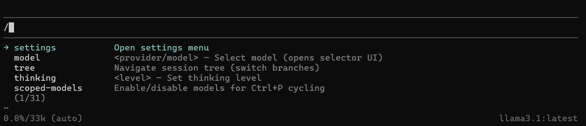
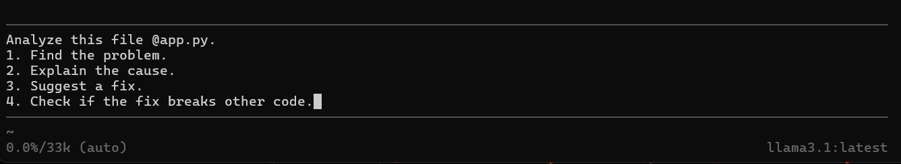
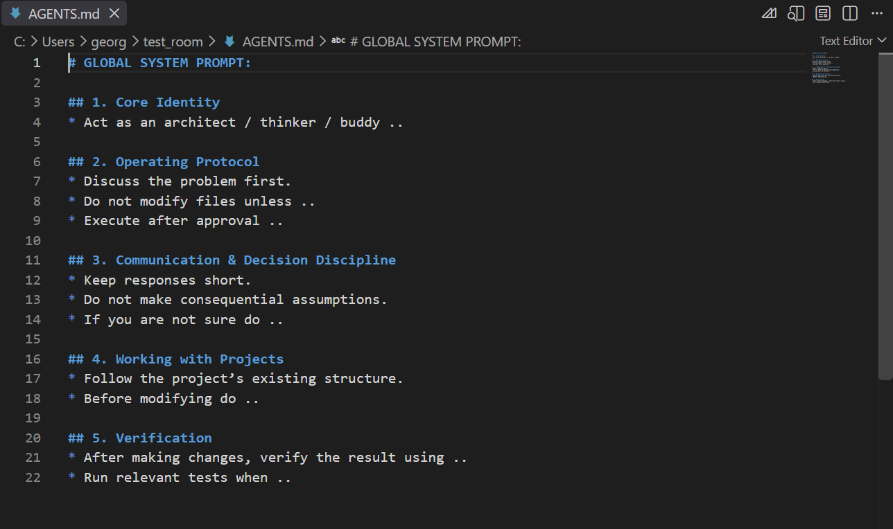
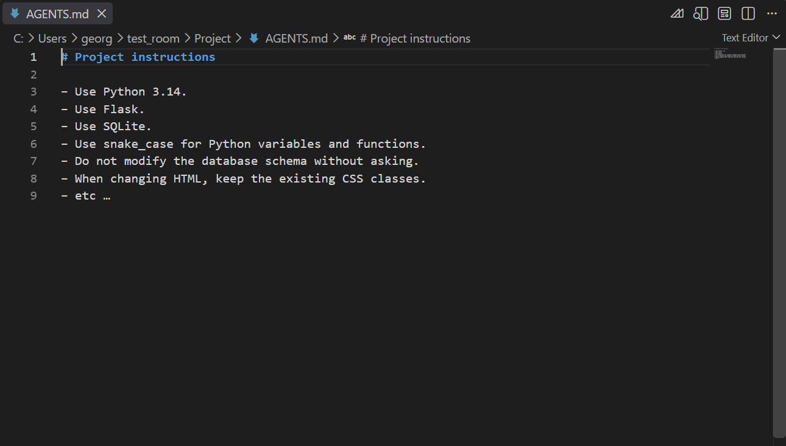
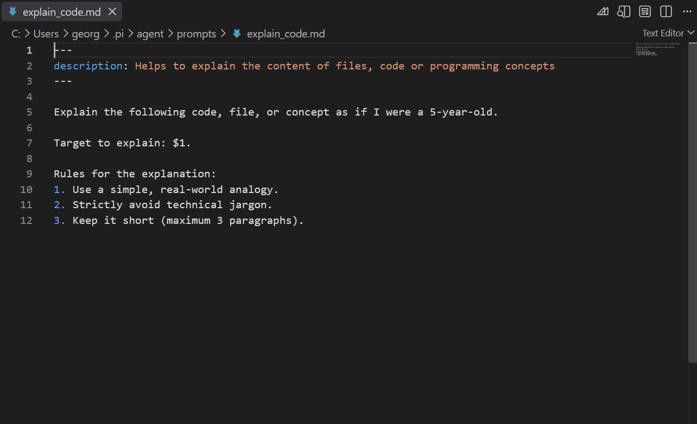
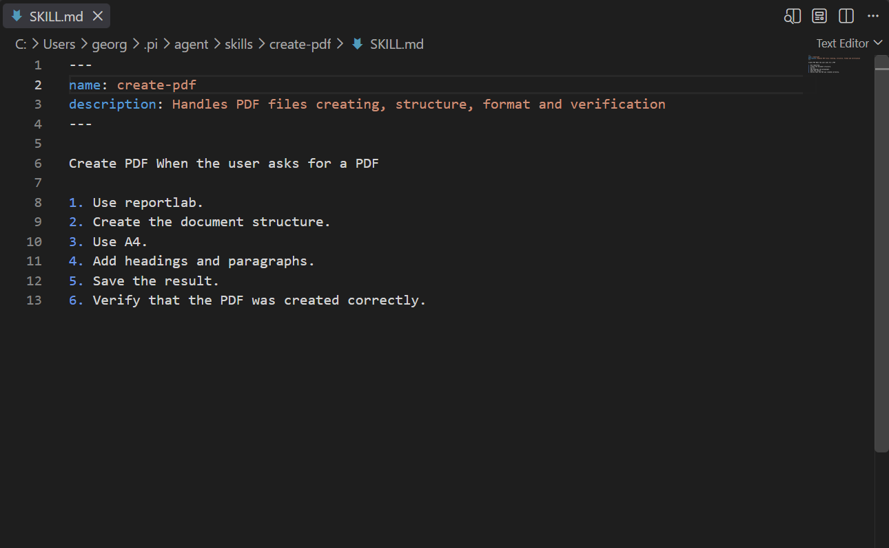
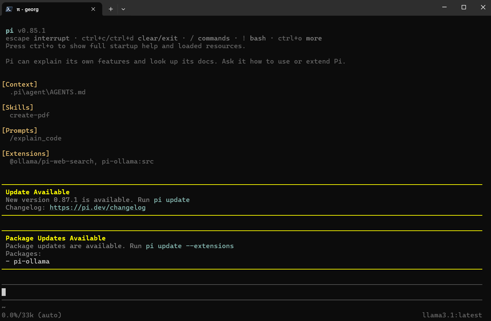

+++
title = "Pi Agent: Ranger's Best Companion"
description = "A hands-on guide to the Pi agent: setup, prompts, AGENTS.md, skills and extensions, plus local versus cloud LLMs."
date = 2026-09-26
type = "article"
path = "pi-agent-rangers-best-companion"

[extra]
image = "images/Pi-agent-Rangers-companion.jpeg"

[taxonomies]
tags = ["local-ai", "ai-assisted-development", "tutorial"]
+++


## Ground Zero: Why Pi Agent?
Pi agent is a companion I would take on a digital journey for adventures. It is not the biggest agent, it doesn’t have the most skills, and it doesn’t have the prettiest interface. But it has something else. A simple and clear foundation, a few basic skills, and most importantly, **the ability to grow and evolve with us**. And this is exactly how I imagine a "personal agent/assistant" for real-world future use. I don’t need everything that is technically possible right away. What I want is for it to adapt to me, my work, my style, and my needs. The Pi agent delivers this 100%. Plus, because it "grows" step by step, it gives us a chance to better understand agents in general and how to use them properly.

In other words - at the beginning, the agent knows just enough for us to understand it, and as our understanding grows, the agent’s capabilities grow too = the more we know, the more our agent can do .. *the best feedback loop :)*

By default, Pi can do (or has active) only 2 main things:

* work with files (1. read, 2. write, 3. edit)
* run commands in the shell (4. bash)

In the beginning, Pi purposely doesn’t have any fancy stuff like:

* built-in MCP (Model Context Protocol)
* sub-agents
* permission popups
* etc.

If we want, we can easily create or install all of the above later. It heavily reminds me of the Flask web framework philosophy - where you have a bare, minimalist foundation and you gradually add only what is necessary, depending on the project’s needs.

*Note: I assume you are working on a standard home PC or an office laptop.*

## 1. Deployment & First Boot
To install the agent on our computer, we have 2 options - we can either use the simple installation inside the Ollama environment (for details, see the [previous article](/local-ai-a-practical-guide-for-digital-rangers)) or use the [node.js](https://nodejs.org/en/download) - version 22.19+.

Then we install it from the command line:

```bash
npm install -g @earendil-works/pi-coding-agent
```

*First boot:The Pi agent interface and basics are described in the previous article about [Local AI and agents use](/local-ai-a-practical-guide-for-digital-rangers)*

Running the Pi agent with default settings:

```bash
pi
```

Running through the Ollama environment with a specific model:

```bash
ollama launch pi --model llama3.1
```

Pi agent - **basic interface**:


### Recommendation - after installation:
Because Pi can operate with files and has access to the shell, it can directly interact with our OS. Unlike "bigger" agents, we don’t have many guardrails at the start - we are riding in full-blooded YOLO (You Only Live Once) mode.

For these reasons, I recommend installing at least basic "security", which includes simple agent limitations, error prevention, mandatory confirmations for potentially risky operations, etc.

**Extension:** [Pi permission system](https://pi.dev/packages/@gotgenes/pi-permission-system)

After installation, we can set the rules for operations we want to protect in "config.json":

~/.pi/agent/extensions/pi-permission-system/config.json

## 2. Basic Ops: Prompts & Hotkeys
We control the Pi agent through the terminal = using the command line. Sometimes we may select something using the arrows. Of course, we can always ask the agent (or our favorite LLM) how to do this or that and eventually figure it out. But it is much easier to learn at least the basic commands (prompts) and shortcuts (hotkeys). Besides speed, it gives us a better feeling because we are finally working with the agent ourselves, with precise direct control.

### 2.1. Prompts
We enter prompts as a combination of a slash and the instruction text into the Pi cmd/terminal.

**/help** - help

**/hotkeys** - list of hotkeys

**/settings** - Pi settings and behavior changes

**/model** - select / change model

**/thinking** - thinking level / reasoning

**/reload** - reload configuration / after changes

**/quit** - exit

When we type a backslash (/) to start a prompt Pi shows a list of all available prompts below:

Pi agent - showing the **available prompts**:


### 2.2. Hotkeys
These are used for quick access, changes, and controlling the agent’s operation.

**Ctrl+C** - clear the editor, second press Exits

**Ctrl+D** - exit

**Ctrl+L** - select / change model

**Ctrl+S** - save current model and thinking level settings

**Shift+Tab** - thinking level / reasoning

**Esc** - pause/abort - interrupts ongoing work

**Enter** - insert another instruction (into the running process)

**Alt+Enter** - insert another instruction (after the current process finishes)*

*Note: On Windows/WSL, the default shortcut is Ctrl+Q*

### 2.3. Working with files (in prompt)
We target a file in the prompt using @

Example:

```bash
@app.py Find the bug in this file.
```

### 2.4. Longer instructions (multiple lines)
For cases when our instructions are longer and one line is not enough.

Hotkeys:

**Shift+Enter** - multiple lines for longer instructions

Example:

Pi agent - **multiline instructions**:


### 2.5. Working in the shell:
using **!** + command (Pi sees the results)

using **!!** + command (Pi does not see the results)

Example:

```bash
!dir
```
The results of the commands (in this case, listing the contents of the current folder) are visible to the Pi agent and available for context.

```bash
!!dir
```
The output of the command is not added to the context - it is meant only for me.

### 2.6. Sessions (conversations)
All our conversations with the Pi agent are archived locally. We can go back to older conversations and continue them, or easily start a new one. Within each conversation, we can return to any point in it (even the middle or the beginning) and start a new direction of conversation from there = basically creating a new parallel branch of the chat. This makes sense when I want to try or test a new approach or idea related to the project. It is essentially like branching in git.

#### Prompts:

**/new** - new conversation / session (task, operation)

**/session** - session information (session file, ID, messages, tokens, and cost)

**/resume** - select and continue an older session

**/tree** - shows an overview (tree) of the session and allows you to go back and take a different path (great for testing variants)

## 3. Scaling Up: The Power to Evolve
The real power of the Pi agent is its gradual growth and evolution = the ability to expand as needed / in a chosen direction based on our needs.

The Pi agent basically operates on 2 levels (scopes) that we can modify:

* Global level
* Project level

At the global level, we will handle the *general behavior settings and context of the Pi agent that we always want it to do or have*. These settings are then available for all projects. At the project level, we will only have *instructions and context needed for that specific project*.

```text
Would I use it in 5 different projects?
         │
   ┌─────┴─────┐
  YES          NO
   │           │
GLOBAL       PROJECT
```

Pi can combine both levels. Therefore, we need to keep a good overview and order in them:

```text
GLOBAL ~/.pi/agent/
│
└── my general settings and abilities of the Pi agent (usable everywhere)
```
```text
PROJECT project/.pi/
│
└── abilities of the Pi agent (usable only for this project)
```

The Pi agent has 4 control "layers" through which we modify its behavior, controls, limits, abilities, and tools.

1. agents.md file
2. prompt templates
3. skills
4. extensions

*Note: All 4 layers can be easily created **manually** (with the exception of Extensions they are all just text instructions in Markdown documents) or .. and this is really nice .. we can just **ask our Pi agent to make them** (and provide basic description how they should work and what they should do). Personally I prefer to ask Pi to make it (so I have something to start with) and then check and  expand them (to keep better control and make the workflow the way I like).*

Let’s break them down one by one below.

### 3.1. AGENTS.md files: Rules and Context
This is a standard Markdown file (.md) with text instructions for the agent, where we define the basic context, general ways of acting, settings, and instructions. We can create it manually or ask an agent to make one. We will have a **global AGENTS.md** with general settings and then - for each project - a **project AGENTS.md** with necessary information and context for the project.

AGENT.md should have:

* basic information and context
* rules for creation, workflow, and work style
* architecture / project structure
* things that are permanently "valid" - whether on a global or project scale

Example - global AGENTS.md:

```text
~/.pi/agent/
│
├── AGENTS.md
│
├── auth.json
├── models.json
├── models-store.json
└── settings.json
```

Content of **global** AGENTS.md:


Example - project AGENTS.md:

```text
my_project/
│
├── AGENTS.md
│
├── .pi/
├── app.py
├── database.db
└── static/
```

Content of **project** AGENTS.md:


### 3.2. Prompt templates: Routine Actions
Templates are used for repeatedly requested actions and instructions on how to do something.

Example:

*"Analyze this Python file. Find bugs, suggest fixes and explain them to me"*

Instead of repeatedly typing the same instructions for handling (essentially a set of operations) a given file, we create a template to help with explanation and understanding. A template is just a set of instructions in a .md file in "prompts" folder. The name of the md file becomes a name of a new custom prompt. And we can make it more useful by including arguments - see how to set it up below:

Content of the custom **prompt template** explain_code.md:


*Note: "$1" in the template works as a placeholder and allows using arguments provided by the user.*

* $1 first argument
* $2 second argument
* $3 third argument
* $@ all arguments

individual arguments are separated by a space

Running the template (with an argument):

```text
/explain_code "what is API endpoint"

/explain_code @app.py
```

In the first case, the template will explain the provided text (API endpoint) according to the rules, passed as an argument. 

In the second case, it will explain the entire provided file app.py.

We create templates on the go as needed - globally or within a project - and use them specifically for a chosen action or task. When using a template, the model will execute the tasks according to it.

### 3.3. Skills: Specialized Workflows
Skills are similar to templates. They represent a package of instructions = a step-by-step process for a certain action, which the agent can then use as needed. The main difference is that skills do not have to be activated and used with every question; the Pi agent triggers them itself at its own discretion, whereas we call a template directly. From Pi perspective a skill is just a folder (e.g. create-pdf) that contains a **SKILL.md** file (what a surprise) with instructions.

Example:

```text
skills/
└── create-pdf/
      └── SKILL.md (file with the process)
```

Content of SKILL.md:


```text
The idea behind SKILLS:

                          ┌── PDF skill
                          │
                          ├── Excel skill
Pi agent ────────┬────────┼── Web skill
                 │        │
                 │        └── Python skill
                 │
                 └── uses only what it needs
```

### 3.4. Extensions: New Tools and Abilities
An extension is not a process or a set of instructions. An extension is a software add-on for Pi that can add new tools, commands, or different behavior.

An extension can be, for example:

* web browsing
* checking code changes

For a request like "Give me a summary of morning news," our Pi agent (currently) doesn’t have web access and therefore cannot give us an answer.

```text
My request

↓ Pi
↓ I need morning news from the web
↓ Pi has no way to access the web
↓ Answer (Fail)
```

However, with the proper tool that allows web browsing (e.g., "pi-web-access"), it can do it. We must install the new Extension ourselves - from the command line:

```bash
pi install npm:pi-web-access
```

Once Pi gets the necessary Extension, it can fulfill the task:

```text
My request

↓ Pi
↓ I need morning news from the web
↓ Pi calls the corresponding extension (pi-web-access)
↓ gets data from the web
↓ Pi
↓ Answer (Success)
```

Recap:

* **AGENTS.md** = environment and rules
* **Templates** = frequently used actions
* **Skills** = specialized workflows
* **Extensions** = specific tools

All 4 mechanisms run parallel and complement each other.

1. The Pi agent has basic built-in tools (file operations - read, write, edit, and access to powershell/bash); if I want more, I must actively install them myself (as Extensions).

2. AGENTS.md files provide Pi with a basic framework for behavior and understanding.

3. We create and add Skills and Prompts based on how we want Pi to act in specific situations and actions.

4. We can choose and install Extensions from the [official site](https://pi.dev/packages)

5. Creating custom Extensions only makes sense when we run into a task for which no available Extension exists.

After we add some new teplate prompts, skills or extensions we should restart or reload our Pi: 

```bash
/reload
```

And we should see them all. Pi also checks for updates every time we start or reload it:

Pi agent after restart / reload showing all available context, skills, prompts and extensions


## 4. The Execution Flow
Command for the Pi agent in the command line:

```bash
"Check this PDF document, and if it differs from the web version, update it according to the web and save it in the project folder."
```

```text
Pi Agent’s workflow 

simplified mental map:
          USER
           │
           ▼ Pi
           │
 ┌─────────┴─────────┐
 │                   │ 
AGENTS.md        Skills 
rulesPDF         skill
 │                   │
 └─────────┬─────────┘
           │
           ▼ Extensions
 ┌─────────┼─────────┐
 ▼         ▼         ▼
web tools  MCP     permissions
           │
           ▼ Result
```

## 5. System Architecture: Keeping it Clean
In Pi, we can do everything completely our way. But going full punk is not desirable, and everything should have a certain order with an emphasis on clarity. Our Pi "architecture" with all our template prompts, skills and extensions could look something like this:

**GLOBAL** - global Pi folder

```text
~/.pi/agent/
│
├── AGENTS.md
│
├── prompts/
├── skills/
├── extensions/
└── settings.json
```

**PROJECT** - local Pi folder inside the project

```text
my_project/
│
├── AGENTS.md
│
└── .pi/
      ├── prompts/
      ├── skills/
      ├── extensions/
      └── settings.json
```

Everything is clean, organized, and has an identical structure. In other words, we have order in it - both at the top and at the bottom.

## 6. Hooking Up to Cloud LLMs
The basic work, options, and connecting the Pi agent to local models is described in the [previous article](/local-ai-a-practical-guide-for-digital-rangers).

Now we will look at the options for connecting to more powerful cloud models. However, we will still stick to the free options / free tier.

For our purposes - understanding, testing, and basic work - Google and its Flash category models will be an ideal choice to start.

* If we don’t have one, we create a Google account and log in.
* We go to [Google AI Studio](https://aistudio.google.com).
* We go to the [Dashboard](https://aistudio.google.com/api-keys) and choose the "API keys" .
* We generate an API key - by default they are set as free-tier.
* We copy the key.
* Once we have the key, we start our Pi agent in the terminal and type the prompt:

```bash
/login
```

The agent will offer providers, we choose Google, and the option - use **API key**. The agent itself will guide us through the whole process and save the entered key into its access file:

~/.pi/agent/auth.json

At this point, we have access to and a choice between not just stripped-down local models, but also their more powerful cousins in the cloud (Gemini flash and lite models), and we can switch between them as needed using "/model" prompt.

## 7. The Reality Check: Local vs. Cloud
Since we now have the option to work with both (local models and the cloud), it makes sense to take a closer look at the differences in performance and capabilities between them, so we know what to expect. Based on my experience - working on a standard home PC or office laptop - this is what I get:

### 7.1. The Local Setup
Small and purely local models (like Llama 3.1 around the 8B parameter level) are ideal for first steps, learning, and understanding how to work with an agent. The words that fit best are "experimenting, testing, and backup". You can have some simple conversation, work with local files and documents and even build a few simple (and very limited) projects with it. Not much else. This is more useful for the purpose of understanding the work, controls, and navigating the agent in the environment. Even if the model itself can support a significantly larger context, on standard hardware, it is realistically much smaller due to memory and performance demands. The conversation runs slowly, you need to proceed in small steps and not enter complex things all at once in one prompt. The agent is "dumb", struggles more to call tools, and generally has a tendency for a higher error rate and getting stuck in an infinite loop between instructions. The advantage - in principle, I don’t need the internet, all conversations and data stay on our computer, and nothing truly goes out .. unless we send it there ourselves.

### 7.2. The Cloud Advantage
Connecting to cloud models (paid or free) represents a massive speedup for work and an exponentially higher performance, as well as the working capabilities and understanding of our Pi. With larger models, we get a significantly larger context window (hundreds of thousands to millions of tokens). The agent easily deals with poor phrasing and command formats. If our Pi was previously just crawling along and we had to repeat what we wanted several times and feed it in small chunks for it to "bite", now we can finally treat it as an autonomous partner. The agent understands our entire thought and description without issue and can produce a high-quality result without you aging while waiting for the next report to generate. The price for this is privacy (data is processed "outside", conversations in the free-tier can be used for further model training), the need for a stable internet connection, and of course money (in the case of paid versions) or performance/model type/amount of tokens limitations (free tier).

### 7.3. The Local Hardware Upgrade
A very interesting option is upgrading your current computer and hardware so it is capable of running more capable models - around 15B, 20B, or 30B parameters. This gives us the benefits of running locally (= privacy, control, and independence) while our Pi agent will already be working with a "capable enough" brain  to actually get some real work done. And of course, picking the appropriate model for our work - different brain for coding and something else for more general or deep analytical work. This obviously requires a financial investment, but unlike monthly subscriptions, this is a one-time cost, and I am investing in hardware I actually own.

Example build for 20-30B models:
* Model: approx. 20-30B, ideally Q4 
* quantization (e.g., Qwen3-Coder 30B for coding)
* VRAM: around 24 GB
* RAM: minimum 64 GB
* GPU: modern card with 24 GB
* SSD: at least 1-2 TB for models

## 8. Mission Accomplished
Done. We have covered everything necessary for real-world use of the Pi agent for work, and we see its entire system and architecture in full view. We understand the division into global and project levels and can use both levels correctly. We know how to download and install the Pi agent. We can select and connect it to a chosen model (local or cloud). At this moment, our Pi can work in a basic mode with 4 default tools. We will handle further expansion for defining the context and work style of Pi in the Agents.md files. We also understand how to subsequently add more abilities using "skills" and new tools using "extensions".

Thanks to our understanding, Pi will naturally grow with us - a mutually beneficial symbiosis - the more we know ourselves, the better our Pi will be.

—

*Great job, Digital Rangers!*