+++
title = "Building a DIY Off-Grid Power System: A Zero-Cloud Emergency Backup"
description = "How to build an Emergency SELV System to power your phone and laptop using solars, charge controllers and batteries. An independent and modular powersource for blackouts."
date = 2026-08-21
type = "article"
path = "building-a-diy-off-grid-power-system-a-zero-cloud-emergency-backup"

[extra]
image = "images/selv-system.png"

[taxonomies]
tags = ["resilience-and-preparedness", "tutorial"]
+++

## Introduction: Comfort, Dependence, and Real Preparedness

Historically, being prepared meant being able to start a fire. That required knowledge, skill, and a few basic tools. The result was proof of mastering energy and gaining light and heat.

Today, civilization is a bit further along, and a campfire isn't enough. Our digital, tech-driven society runs on electricity. Our task remains the same - to have basic knowledge, skill, and a few necessary tools. And when needed, to demonstrate our skills and ability to be prepared.

---

Relying on global infrastructure means two things: **comfort** and **dependence**. As long as everything runs, no problem. However, in a crisis, outage, or limited operation, we quickly realize the massive difference between "electricity is on" and "electricity is off."

Today, we simply need electricity to function. And since nobody will handle the truly important things for us, if we want "our own power," we have to **build it ourselves**. So let's get our hands dirty and build something.

Our goal will be a simple, resilient, and fully analog low-voltage system (**SELV**) with zero dependence on mobile apps, Bluetooth, or the cloud. Because if trouble comes, we don't want to rely on anything outside our reach, control, and access - no mandatory internet connection, no app reliance, nothing of the sort. We will explore the options and build a **backup system** suitable for a cabin, a small expedition, or as a personal home emergency blackout backup.

**Mission:**

* Backup for small technology dedicated to work and critical communication.

* System must supply power to charge a laptop, 1-2 smartphones, power banks, and basic lighting.

* We will not power large household appliances (pumps, washing machines, water heating, etc.).

| Glossary | Meaning | Description |
|:---|:---|:---|
| SELV | Safety Extra Low Voltage | Safe, extra-low voltage, separated from other networks, ungrounded |
| AC | Alternating Current | World of high voltages and low currents |
| DC | Direct Current | World of high currents and low voltages |
| W | Power | Energy per second, usually used to measure consumption or output |
| Wp | Watt-peak | Maximum power output under ideal conditions |
| U | Voltage | Energy "pressure", measured in volts (V) |
| R | Resistance | Difficulty of energy flow, measured in ohms (Ω) |
| I | Current | Amount of energy flow, measured in amperes (A) |

## I. Off-Grid Component Selection

First, let's look at the commonly available options for assembling an independent (**off-grid**) system. Then, considering our situation, needs, and budget, we will pick suitable components and wire them up.

For our independent system, we only need **3 core elements**:
* **1. Energy harvesting**
* **2. Charge management**
* **3. Energy storage**

### 1. Energy Harvesting - Solar Panels (Mono vs. Poly)

**Monocrystalline (Mono)** - Black: 

More efficient (approx. 20-25%) and perform better in lower light or overcast conditions. Two main types exist: rigid and flexible. **Rigid panels** are highly efficient, easy to angle for maximum solar yield, have a long lifespan (20-30 years), but are heavier. **Flexible panels** are lightweight (50-70% lighter), can fit curved surfaces, but are more expensive, less efficient (approx. 10-15%), and have a shorter lifespan.

**Polycrystalline (Poly)** - Blue: 

Generally cheaper than Mono, but require more surface area to produce the same power output.

### 2. Charge Management - Controllers (MPPT vs. PWM)

**PWM (Pulse Width Modulation)** - "The Energy Butcher":

If the panel outputs 18V and the battery is at 13V, PWM simply chops the panel voltage down to 13V. It discards the excess energy. Operation involves higher energy loss, but the purchase cost of PWM is low.

**MPPT (Maximum Power Point Tracking)** - "The Smart Alchemist":

MPPT is a sophisticated DC-DC converter. Instead of wasting excess energy, it converts voltage surplus into additional current (adjusting voltage and current dynamically). It costs more than PWM, but operational efficiency is significantly higher. 

Additionally, it features reverse current protection and allows setting specific "charging profiles" for each battery type (LiFePO4 requires different handling than lead-acid).

### 3. Energy Storage - Batteries (Lead-Acid vs. LiFePO4)

**Lead-Acid Battery** is relatively cheap and easy to get compared to LiFePO4 but there are downsides as well:

* **Depth of Discharge (DoD):** Lead-acid can only be discharged down to 50%. If you have 30 Ah available, real usable capacity is only 15 Ah. LiFePO4 can be safely drained to 90%.

* **Weight:** At the same capacity, LiFePO4 is approx. 3x lighter.

* **Lifespan:** Lead-acid lasts 300-500 cycles. LiFePO4 gives 3,000-5,000 cycles.

A quality **LiFePO4 Battery** features a built-in BMS (Battery Management System). It monitors:

* **Over-voltage:** Prevents panel overcharging.

* **Under-voltage:** Prevents deep discharge to zero.

* **Short-circuit:** Instant disconnection in case of a short circuit.

* **Cell balancing:** Ensures equal voltage across all cells.

*Note: LiFePO4 must never be charged if cell temperature drops below 0°C (32°F), as lithium plating occurs. Discharging in sub-zero temperatures (down to approx. -20°C) is fine.*

## II. Wiring, Fusing, and Safety in DC Systems
Harvested energy has to flow through physical conductors, so we must pay strict attention to proper mounting surfaces, wiring, and protection. Since we operate in a **DC environment**, circuit protection requires higher standards than common household AC setups.

**DC Wiring:**

* Power cables and solar input cables are selected based on current load (A) and voltage drop (V) caused by cable length in a 12V system.

* Power cables require crimped ring terminals, solar cables use MC4 connectors, and we prepare a set of wire ferrules (2.5 mm², 6 mm², and 10 mm²) for connections to circuit breakers, charge controller, and fuse blocks.

**Circuit Breakers and Fuses:**

* Breakers and fuses protect cables from short circuits, not appliances.

* Place them on positive (+) lines as close as possible (approx. 10-20 cm) to the energy source (primarily the battery).

**Mounting and Surface:**

* Mount or attach the charge controller and DC breakers onto a non-flammable substrate (e.g., Cembrit board, sheet metal, or flame-retardant laminate).

## III. Assembling the SELV System

For our **emergency SELV** setup, the ideal combination consists of a rigid monocrystalline solar panel, an MPPT charge controller, and a LiFePO4 battery with the required capacity. 

Low-draw devices (e.g., LED lights) connect directly to the controller's load terminals. Higher-draw devices (laptop, phones, power banks) connect via step-down/step-up converters (with appropriate ends, e.g., USB-C) directly to the battery.

For the Charge management part of the system I think EPEVER offers a really good combination of reliability, independence and price but feel free to use any brand that suits you.

*SELV System Schema:*

*NOTE: Connect the battery to the MPPT controller FIRST. The controller must boot up and detect system voltage (12V). Connect the solar panel to the MPPT controller SECOND. (When disconnecting, perform these steps in exact reverse order.)*

### 1. Energy Source (Solar Panel)

**Panel:** 200W-300Wp rigid framed Monocrystalline panel.

**Solar cabling:** Approx. 6 mm² cross-section (calculated for 10-20 m length).

Connect cables from solar panel (MC4) to solar input terminals on the controller.

Install a 20A DC circuit breaker on the positive cable directly next to the controller.

### 2. Charge Management

The charge controller regulates safe battery charging from solar power (DC to DC).

**MPPT Controller:** 

EPEVER Tracer 2210AN (20A) - handles up to 260W at 12V. (If using a 300Wp panel, it will automatically clip any excess power).

**Display:** 

EPEVER MT50 display for physical control - no phone or app needed.

* Connect the MT50 display cable to the controller's RJ45 port.

* Configure battery parameters (charging profile, cut-off voltage, etc.) directly via the screen.

### 3. Energy Storage

**Battery:** 

LiFePO4, 12V, 100Ah, with low-temperature BMS protection (prevents charging below 0°C).

**Power cabling:** 

Approx. 10 mm² cross-section (calculated for < 3 m length) connecting battery and controller.

Install a 30A DC circuit breaker on the positive cable right next to the battery. Once connected, the controller detects system voltage (12V battery).

### 4. Power Outputs and Consumption

**USB-C Buck-Boost Module (100W):** 

Converter for charging **smartphones, power banks, and laptops**.

* Connect directly to battery terminals (via a 15A inline DC fuse/breaker).

**Fixed 12V Distribution (LED Lights):**

* **Twin-lead wire for lights and auxiliary USB modules:** approx. 2.5 mm² cross-section (calculated for 10-20 m length).

* Connect via a fused terminal block directly from the battery, or from the controller's LOAD terminals (strictly for low loads up to 10A).

---

### Emergency SELV System Functionality

With a 100 Ah LiFePO4 battery, total stored energy is 1,280 Wh (assuming 90% real discharge, usable capacity is ~1,150 Wh).

Real loads and runtime strictly on battery power (with 0% solar input):

* **Smartphone (~15 Wh per full charge):** ~70-80 full charges.

* **12V LED Lighting (5W strip/bulb):** >200 continuous hours.

* **Laptop (working consumption ~25W / battery capacity ~60 Wh):** ~19 full charges (or ~46 hours of direct work).

### Example - Critical Scenario (No Sun):

**Daily usage:** 

1x full laptop charge + 2x phone charges + 5 hours LED light (= daily load approx. 115 Wh).

**Result:** 

The battery guarantees full operation for approx. 10 consecutive days.

## IV. True Independence vs. Disposable Tech

Our **Emergency SELV system** is complete. Building it in a **DIY** style refreshed our basic understanding of electricity and likely taught us something new. More importantly, we gained a solid degree of **independence** and **self-reliance** - during a multi-day blackout, we have a reliable power foundation ready for work and survival.

Because our system is **modular** and we understand how components interact, where energy flows, and how everything connects, we can easily replace or repair individual parts.

Unlike sealed off-the-shelf "black boxes" from cheap online marketplaces, this setup gives us maximum freedom and the **ability to maintain or upgrade our SELV unit** in the future. Not to mention the feeling of accomplishment - building something with your own hands beats buying a glued plastic box with zero effort and zero understanding, only to throw it away when it fails a few months later.

Time to pat ourselves on the back. Solid, honest work done.

p.s. Storage & Maintenance tips:

* Perform a battery check once every 3 months.

* Ideal state for long-term storage is keeping the battery at 40-60% capacity.