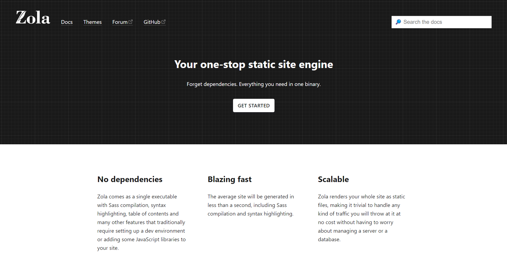

+++
title = "My Website, My Castle: Building an Independent Digital Realm"
description = "Why build your own static website? Let's explore how to get digital independence and better website security using Markdown, Zola and free hosting with GitHub Pages."
date = 2026-11-13
type = "article"
path = "my-website-my-castle-independent-digital-realm"

[extra]
image = "images/my-web-my-castle.jpg"

[taxonomies]
tags = ["web-development", "resilience-and-preparedness", "tutorial"]
+++

We live in a digital age, and the digital space is just as real to us as the physical one. In the physical world, it is **"my home - my castle"**. In the digital world, it is **"my website - my castle"**. Of course, it is possible to express yourself on a smaller playground - a Facebook page, an Instagram profile, TikTok, LinkedIn, and so on. However, this comes with consequences. Such a place is already set up and everything is taken care of, but I lose **ownership and independence** - both of my profile and all my data. The provider can use my data for its own purposes or cancel my account at any time and for any reason, and I lose absolutely everything without compensation. 

Anyone who has ever tried to resolve anything with an AI support bot (because, as part of cost optimization, they no longer have traditional human support) knows that account recovery takes weeks or months, and nobody can guarantee that it will succeed. Not to mention having to accept the given system, it's behaviour .. and furthermore constantly self-censor so as not to expose yourself to bans or restrictions on the reach of your posts imposed by the infrastructure owner - and these restrictions that can literally come at any time. This applies to both personal and business web spaces.

## Part I - Taking Back Digital Independence

OK - so let's show some rebellious spirit, break the chains of digital thralldom, try to escape slavery, and lay the foundations for our own **web kingdom**. It is time to take back our data and freedom. There are countless possibilities, but in fact there are only two:

1. Build my website on some platform (CMS) using predefined templates, blocks and tools, +- some use of AI.
2. Build the website myself +- some use of AI.

### Dynamic Websites and CMS Platforms

Option 1, which is usually a **dynamic CMS** based on WordPress (WP) or something similar, is quite tempting - I don't need to invent anything, and I can immediately see what my chosen template looks like and how it works. I can edit, style and change everything. It is easy. It is fast. But once again, I end up in the same place - dependent on the provider, its rules and its limits. Over time, I start drowning in a flood of all those options, features and various settings. And these little creatures have a tendency to keep accumulating with updates. Not to mention the pointless AI-enhancement of everything these days.

### Why Go Static?

Most personal and business websites are essentially online business cards: a brief introduction and an overview of services, together with contact details, sometimes with a blog section containing articles. That means standard pages such as Home, About, Contact, Services and Blog. Nothing more, nothing less. And I don't need anything complicated to create these few pages with links, text and some images. This is a simple **static website**. Various hacks and features such as interactive contact forms are also pointless in this case - unless I am a government institution or plan to collect and manage visitors' data or to store them in a database (DB). That would also expose me to obligations arising from **GDPR**. An ordinary email address is more than enough for contact. Besides, visitors will definitely appreciate direct contact more. Last but not least, by going "static" we will **no longer need to pay** the CMS providers for their services and hosting - and trust me - this feels really good. 

### Building Your Own Static Website

So let's move on to option 2 - it will be a static website, and we will build it ourselves. If we already have our website hosted by some provider, we will prepare for migration. Before we start building anything, we need to get our working materials (= our data) in order. We will want to use *clear, well-organized and structured data and information* (both text and visuals). If we have been keeping everything in files such as Word documents named `new_file5.doc` and tucked away somewhere on the desktop, it is time to put an end to that and reorganize our projects and folders, including their naming conventions. 

So we will forget about various office applications and move to something modern that is easier to manage with future development in mind. Based on my experience, using files such as **Markdown (MD)** makes sense, for example. In other words, we will carry out a larger or smaller digitalization of our "raw data materials" and finally get them in order. AI can help us quite a lot here, by the way - both with the conversion and editing, and with choosing suitable options. We will make use of that. Our goal is to have organized, high-quality data that we can easily manage and use ourselves. Because the time is now.


```text 
Having your own website does not, of course, mean absolute independence. At the very least we gain the freedom to move our content and files elsewhere with ease.
```

Once this is done, we can move on to the next step - deciding how to create our own website in a simple way. Again, we have two options:

1. A combination of HTML + CSS, possibly with a little JavaScript (JS) to load content from MD files.
2. Use some generator to create static content (SSG).

| Website type | Example | Technology | Principle |
|---|---|---|---|
| **1. Static website** | [website](https://andesresilience.com/) | HTML + CSS | A pre-built landing page - an HTML page. CSS defines its appearance. No JavaScript. |
| **2. Static website with dynamic rendering** | [website](https://curator.georgefreedom.com/) | HTML + CSS + JS + Markdown | JavaScript loads content from Markdown files and displays it dynamically in the browser. |
| **3. SSG (Zola)** | [this website you are on](https://georgefreedom.com/) | Markdown + Tera + CSS + SSG | During the build, the SSG converts Markdown files and templates into ready-made HTML pages. |

Personally, I think this is a good rule of thumb for making the decision: if I don't plan to change the content very often or I just want to built it once and let it be, option 1 is more than sufficient. If I expect some changes in future , or if the website is going to include a blog section that is regularly updated, option 2 is the way to go.

There are many tools that can function as an SSG. Let's take a look at several different approaches to get a clearer picture.

* **Flask** - a lightweight dynamic web framework (so SSG is just a little part of what it can be used for) that, in addition to easily generating web pages, allows us to incorporate program logic, work with APIs and connect to a DB. It requires Python as its runtime environment. It gives us maximum freedom in what we build and how we build it.

* **MkDocs** - an SSG focused on creating clear, well-organized project documentation. Content is created in MD files, it requires Python as its runtime environment, and its configuration is stored in a YAML file.

* **11ty (Eleventy)** - rich and flexible SSG offering considerable freedom in the use of many "templating" languages, component options and different content sources. It is possible to retrieve data from external sources (external APIs). It requires a JavaScript runtime environment (Node.js). Risk of dependencies (Dependency Hell).

* **Zola** - an simple SSG focused on speed and independence. It gets its content from MD files and uses Tera (similar to Jinja) as its templating language. Data can be retrieved from local files such as TOML, JSON and CSV. It does not need any special runtime environment. It does not rely on any external libraries (Zero-dependency).

At this point, things start to get interesting, because when choosing we need to consider what we want (and why), what seems interesting to us, and what we already have experience with (or would like to gain experience with). In short, don't make things unnecessarily difficult for ourselves.

---

My own decision-making process looked like this:

* I really do like the approach taken by **Flask** - it adds and uses only what is needed. It gives us freedom when building a project, and the Jinja templating language is clear and easy to follow. I work with the Python ecosystem and Flask on a regular basis. However, in keeping with my own philosophy, it is an unnecessarily "heavy" weapon for this "lightweight" project.
* **MkDocs** looks also good. Python again, which is great. Simple content creation from MD files - awesome. Easy project configuration. However, the result is genuinely designed primarily for clear project documentation, and visually it simply isn't attractive (for building a website).
* **11ty** offers freedom and a wide range of options. But that comes at a price - the risk of dependencies and obsolescence. Freedom that creates dependency is not freedom. The sheer number of choices and approaches will not make my work easier; it will only distract me unnecessarily.
* **Zola** has limitations. But those limitations are actually things I would choose myself - for example, content from MD files and the use of data from local sources. So, for me, they are not limitations. The Tera templating language is very similar to Jinja from Flask. From my point of view, it does not offer unnecessary choices or impose unnecessary requirements. It brings independence, simplicity and speed.

In the end - because less is more - I choose **[Zola SSG](https://www.getzola.org/)**.



### Securing Your Digital Fortress

Just as our "castle" in the physical world is exposed to the forces of nature and various questionable characters whose aim is, at the very least, to damage our walls, use the fruits of our efforts for their own malicious purposes, and preferably walk away with the castle treasure, our digital fortress will also be exposed to digital attacks. Let's make a brief comparison.

A **dynamic website** includes a running web server that handles visitor requests: it executes code, communicates with a database (DB), and manages plugins, user accounts and the administration interface. The overall attack surface is therefore *relatively broad and includes many different potential attack vectors*.

*The security of a **static website** is at a significantly higher level* - simply because an attacker can only target what the website actually has. And a static website simply doesn't have most of those things. The server only delivers prepared files (finished HTML pages) in response to visitor requests. There is no DB, and no user or administrator accounts or access permissions are managed. Of course, vulnerabilities remain at the infrastructure/hosting provider, domain administrator and so on. However, that applies to dynamic websites as well.

If we were to compare them metaphorically to castles, a dynamic website would be an imposing castle that actively communicates with its surroundings in every possible way, welcomes envoys of various levels of importance from different countries, and regularly holds markets and celebrations. A static website is a simple rock fortress that I can approach to ask for directions or information, and the fortress will answer. But it will not let me inside, nor will it discuss anything else with me. It treats all visitors equally, and nobody has a privileged position or access.

## Key Terms

### 1. Website Concepts & Publishing

| Term | Explanation |
|---|---|
| **CMS (Content Management System)** | A system for managing website content, usually through an administrative interface. WordPress is a common example. |
| **SSG (Static Site Generator)** | A tool that automatically generates a complete static website (HTML, CSS, JS) from content and templates. |
| **Static Website** | A website made up of pre-generated files that a server simply delivers to visitors. Pages do not need to be generated dynamically with every visit. |
| **Dynamic Website** | A website whose content or output is generated at runtime, for example using Python, a database, or an API. |

### 2. Web Technologies & Content

| Term | Explanation |
|---|---|
| **HTML (HyperText Markup Language)** | A markup language that defines the structure and content of web pages. |
| **CSS (Cascading Style Sheets)** | A style sheet language used to define a website's visual appearance, including colors, layout, and typography. |
| **JS (JavaScript)** | A programming language used to add interactivity and dynamic behavior to websites. HTML defines structure, CSS controls appearance, and JavaScript handles behavior and interaction. |
| **MD (Markdown)** | A lightweight markup language for writing structured text. Commonly used for articles, documentation, and website content. |
| **Template** | A predefined structure that determines how a web page is rendered. Templates help separate content from presentation. |

### 3. Data Formats

| Term | Explanation |
|---|---|
| **TOML (Tom's Obvious Minimal Language)** | A human-readable configuration file format designed to be easy to read and write. Zola uses it for its main configuration file (`zola.toml`). |
| **JSON (JavaScript Object Notation)** | A lightweight data-interchange format that represents structured data using key-value pairs and arrays. Commonly used in APIs and data exchange. |
| **YAML (YAML Ain't Markup Language)** | A human-readable data serialization format that uses indentation to represent structured data. Often used for configuration files (.yml). |
| **CSV (Comma-Separated Values)** | A simple text format for storing tabular data, where each line represents a row and values are separated by delimiters, usually commas. |

### 4. Application Concepts

| Term | Explanation |
|---|---|
| **API (Application Programming Interface)** | An interface that allows different applications and systems to communicate and exchange data. |
| **DB (Database)** | An organized collection of data that applications can store, retrieve, and manage. |
| **Framework** | A software structure and collection of tools that provides a foundation for developing applications or websites. |

## Part II. - Building Your Digital Realm with Zola

### 1. Installing Zola and Creating Your Project

Download and install Zola from the [official website](https://www.getzola.org/documentation/getting-started/installation/). After installation, use the command line to navigate to the location where we want to create the project folder, run Zola and create our project:

```bash
zola init my_digital_realm
```

Zola will then ask us a few questions (for example, the planned URL of our website, etc.). Our answers will be saved in the project configuration file, `zola.toml`, and we can change everything at any time.

The project folder - in our case, `my_digital_realm` - will have the following basic structure:

```text
my_digital_realm/
    |
    ├── zola.toml (main project configuration)
    |
    ├── content (website content - pages and articles in MD files)
    ├── sass (special styles - Sass/SCSS)
    ├── static (static files - CSS, JS, favicons, files, etc.)
    ├── templates (HTML templates)
    └── themes (external Zola themes)
```
*Note: If we **do not plan** to use special styles or themes, we can ignore or even delete the `sass` and `themes` folders.*

### 2. Creating and Organizing Standard Pages

Now we will organize the data for all our pages, stored in MD files, within our project.

Inside the `content` folder, we will create a separate folder for each individual page (About, Contact, etc.). Each folder will contain an MD file named `index.md` with the content of the future web page. If we have any additional files that we will use on that page (for example, images), we will store them here as well - either directly in the folder or in another folder of their own.

```text
content/
│
├── about/
│   ├──img/
│   └── index.md
├── contact/
│   ├── img/
│   └── index.md
...
```

The MD file containing the web page content will include metadata, which we will use not only for the description itself but also when generating the web page. We will therefore create what is known as **front matter**, using TOML formatting (`+++`), and include any data we consider useful (e.g. title, description, date, etc.).

`content/about/index.md`
```markdown
+++
title = "About"
description = "About page of Degital Realm project."
date = 2026-11-13
+++

# Digital Realm About page

This a digital land for my project ...
```

Once we have our content ready, we will move to the `templates` folder and set up the appearance and rendering of the pages. We will create the files `base.html` and `page.html`.

*Note: To insert content into an HTML file, we will use the Tera language with curly braces.*

In the `base.html` template, we will prepare the basic appearance of our web pages - a shared layout. We will also prepare a place for inserting the future content of individual pages using the `block content - endblock`. We will see the use of curly braces whenever we want to "inject" some dynamic content into our HTML templates - that's **Tera templating language**.

`templates/base.html`
```html
<!DOCTYPE html>
<html>
<head>
    <title>My Digital Realm</title>
</head>

<body>
    <main>
        
        
        
        
    </main>
</body>
</html>
```

Once the basic appearance of the website is ready, we will create `page.html`, where we will define how the actual content is rendered. At the beginning, we must remember to specify that we will use the layout prepared in the basic `base` template by using `extends "base.html"`. In other words, we will use **inheritance** that will allow us to use and re-use our templates.

All the content of the MD file will be rendered using `page.content`. If needed, we can also make use of the metadata - we can always access it using the combination of `page` + the name of the field (`page.title`, `page.date`, etc.).

`templates/page.html`
```html




    <h1>{{ page.title }}</h1>
    <p>Written: {{ page.date }}</p>
    {{ page.content | safe }}


```

At this point, we have taken care of the content and its rendering for all standard pages. Two **special cases** remain:

* **Home page** (what I see at the base URL)
* **Section** (organizing a group of pages - for example, a Blog with links to articles)

### 3. Building the Homepage

First, the project's **Home page**, because this is simple. We will handle it by creating an `index.html` file in the `templates` folder. We must remember to inherit from `base.html`.

`templates/index.html`
```html




    <h1>Welcome !</h1>
    <p>This is Realm's Home page.</p>


```

### 4. Organizing Content with Sections

Now let's look at organizing a group of pages using so-called "sections". For this organization, we will need a special file named `_index.md`.

By creating it, we turn the given folder into a "section", which will follow the rules defined in `section.html` - not the rules of `page.html`.

```text
└── blog/
    ├── _index.md (označí danou složku jako "sekci")
    │
    ├── article-one/
    │   ├── img/
    │   └── index.md
    ├── article-two/
    │   ├── img/
    │   └── index.md
...
```

The `_index.md` file will contain only the metadata needed for the given group of pages - for example, for a Blog with tech articles:

`content/blog/_index.md`
```markdown
+++
title = "Blog"
description = "Articles about technology and digital independence."
+++
```

In the templates, we will create a file named `section.html`, where we will define how the content is rendered. As with a regular page, we can also access the metadata of the given section - this time using `section` + the field name (`section.title`, `section.description`, etc.).

Zola includes all pages contained in the section folder in the content of each section. We can then access these pages in the standard way using `page` + the field name.

`templates/section.html`
```html




    <h1>{{ section.title }}</h1>
    <p>{{ section.description }}</p>

    
        <h2><a href="{{ page.permalink }}">{{ page.title }}</a></h2>
        <p>{{ page.description }}</p>
    


```

*Note: `page.permalink` returns the full URL of the given page.*

**Summary:**

* **`index.md`** file (regular page) - the content is rendered according to the rules in **`page.html`**.
* **`_index.md`** file (organizational page) - the content is rendered according to the rules in **`section.html`**.

### Bonus: Taking Control of the Homepage

In case we want to have better control over the Home page, we can keep its rendering in `templates/index.html` and move the content into an MD file, which we will store (like all the other pages) in the `content` folder.

This makes very good sense. In addition, we maintain the same principle (content in MD files) and logic (rendering according to templates) as with the rest of the website. So let's do it.

First, we will move the content into an MD file named `_index.md` and save it in the `content` folder. This creates a **root section** in the content folder.

`content/_index.md`
```html
+++
title = "Digital Realm"
+++

Welcome!

This is Realm's Home page.
```

Once this is done, we can easily insert the content into the `index.html` file using Tera and, if needed, make use of the metadata again.

`templates/index.html`
```html




    <h1>{{ section.title }}</h1>
    {{ section.content | safe }}


```

### 5. Web Styling and Behavior

We store all website styling and behavior in CSS and JS files in the `static/` folder and apply them in templates as needed.

In the template, we "wrap" the selected part by "catching" it for subsequent styling:

`templates/page.html`
```html




    <main class="page-content">
        <h1>{{ page.title }}</h1>
        <p>Written: {{ page.date }}</p>
        {{ page.content | safe }}
    </main>


```

We can easily define our own classes in the CSS file:

`static/css/style.css`
```css
.page-content {
    max-width: 800px;
    margin: 40px auto;
    padding: 25px;
    background: #f5f5f5;
}

.page-content h1 {
    font-size: 2rem;
    color: #333;
}

.page-content p {
    color: #777;
    font-size: 0.9rem;
}

...
```

Do not forget to link the CSS styles in our file to the pages - we will add a link to the main template:

`templates/base.html`
```html
<!DOCTYPE html>
<html>
<head>
    <title>My Digital Realm</title>
    <link rel="stylesheet" href="static/css/style.css"> <!-- CSS style link -->
</head>

<body>
    <main>
        
        
        
        
    </main>
</body>
</html>
```

### 6. Building and Previewing the Website

Once we have connected the content of the MD files to its rendering on the pages, and once we are satisfied with the visual appearance, it is time to see how the whole website system works and looks. In the project folder, we run the following commands in the command line:

* **To start a local web server** for pre-viewing the website - it automatically updates the output when files change:
```bash
zola serve
```

* **To check the project** - for example, for invalid links or missing files:
```bash
zola check
```

* **To generate our entire static website** into the `public/` folder:
```bash
zola build
```

Generating the website is useful as a final check just before we proceed to deployment and publication.

### 7. Deploying and Publishing Your Website

If we decide that our website is good enough, all that remains is to put it online. To keep things as brief and simple as possible, we will choose GitHub to host our project.

At this point, we have two options:

* **Manual deployment** + GitHub Pages hosting
* **GitHub Actions deployment** + GitHub Pages hosting


#### 7.1. Manual Deployment with GitHub Pages

The simpler option means simply generating and transferring the finished website. First, we generate the static website into the `/public` folder:

```bash
zola build
```

Then we create a new repository on GitHub and copy the entire generated website into it.

In the repository:

* Go to **Settings > Pages**.
* Set **Build & Deployment: Deploy from a branch**.
* Enter the domain for the website.
* Select Enforce HTTPS.

*p.s. We must not forget to configure the DNS records with our domain provider so that they point to our GitHub.*

And that's it - after a few minutes, our website will be available at the specified domain :)

#### 7.2. Automated Deployment with GitHub Actions

The principle is almost identical. The difference is that the website generation (`zola build`) takes place directly on GitHub.

In the repository:

* Go to **Settings > Pages**.
* Set **Build & Deployment: GitHub Actions**.
* Enter the domain for the website.
* Select Enforce HTTPS.

For an automatic build, we need to add a folder for GitHub (`.github`) to the project, containing the instructions for building the website.

```text
my_digital_realm/
    |
    ├── zola.toml 
    |
    ├── .github/ (Github folder)
    |       └── workflows/
    |           └── build.yml (file with build instructions)
    ├── content 
    ├── sass 
    ├── static 
    ├── templates 
    └── themes 
```

The `build.yml` file will contain instructions for GitHub Actions:

1. Start the assigned action (for example, when pushing to the `main` branch).
2. Prepare the environment and install Zola.
3. Run `zola build`.
4. Pass the generated `public/` folder to GitHub Pages for publication.

To get a better idea of the principles and logic behind a YAML file, the workflow would look approximately like this (this is only an illustration, not a working deployment configuration):

`.github/workflows/build.yml`
```yml
name: Build website

on: [push]

jobs:
  build:
    runs-on: ubuntu-latest

    steps:
      - name: Get project files
        uses: actions/checkout@v4

      - name: Build with Zola
        uses: getzola/github-pages@v1
```
*Note: A YAML file is not the `zola build` command. It is a set of instructions telling GitHub what and how to run something and what to do with the result.*

Explanations:

- `on: [push]` - starts the workflow when changes are pushed to GitHub.
- `jobs` - defines the tasks.
- `steps` - individual steps.
- `checkout` - downloads the project source files.
- `getzola/github-pages` - runs Zola and prepares the output for GitHub Pages.

We then need to version our project (the local folder on our computer) using Git and connect it to a GitHub repository. When we add new pages or upload a new version of the website after making changes, we use Git commands:

1. Record the changes (`git add`, `git commit`).
2. Use `git push` to send the changes to the GitHub repository.
3. GitHub Actions automatically starts the build and publishes the website through GitHub Pages.

---

**Manual build and publishing** (using `zola build` and then moving the result to GitHub) is suitable for smaller websites with occasional updates. We do not need to deal with any YAML configuration file. We have full control over all changes and files and make them manually. Also a good option for "one-off" websites.

**Automated build** (using GitHub Actions) is a better choice for websites with more frequent changes and publication of new pages/articles. We need to configure a YAML file. Every time we push, the website is automatically built and generated. Generally, this is a better option where we expect to manage and grow the website over the longer term.

## Final Thoughts

Done. Good job!

So, what have we actually gained? First, we got our data organized and converted it into a more usable format - Markdown is simply great. Second, we took matters into our own hands and built our own website, which we now host (for free!) on GitHub Pages. This has allowed us to remove our dependence on web providers and their solutions - so we no longer need to pay for their services. And third, just by switching to our own static website, we have also improved its overall security and availability. And if any problems arise, it is very easy to simply "pack up" our website, move it, and host it somewhere else.

Managing and updating the website is also significantly easier and more straightforward - because it is our own system and environment, which we built to suit our needs, rather than the other way around.

In exchange for a little work and learning, we have gained a great deal of freedom and independence in the digital space. And a good feeling, too!

—

*We have built our own Digital Realm !*