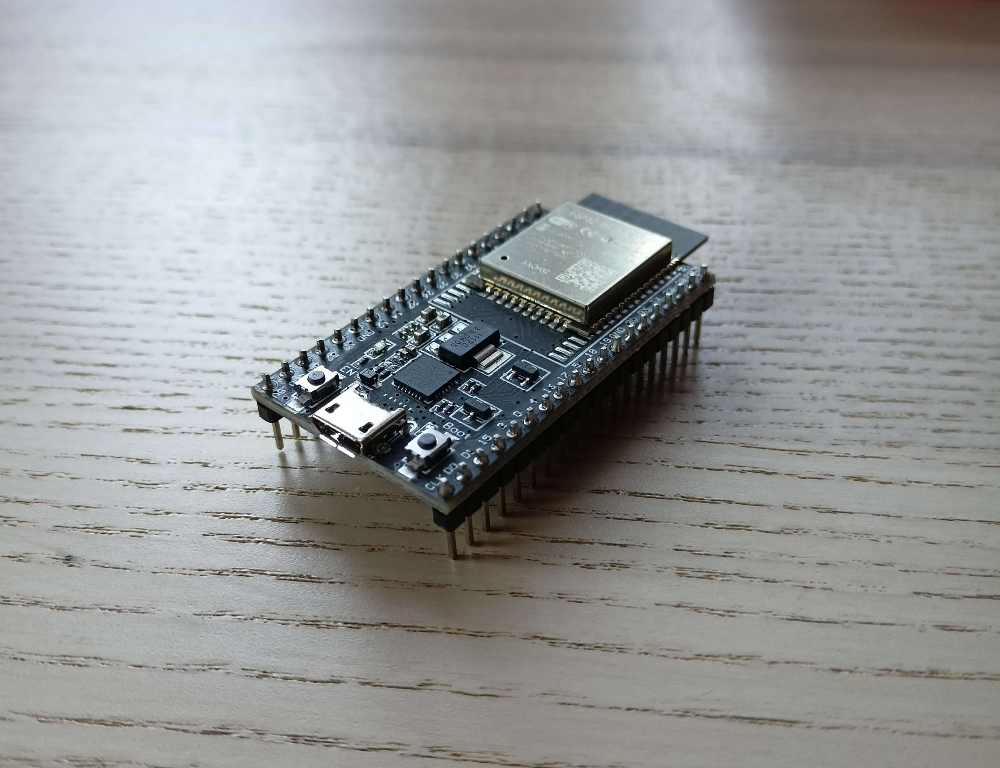
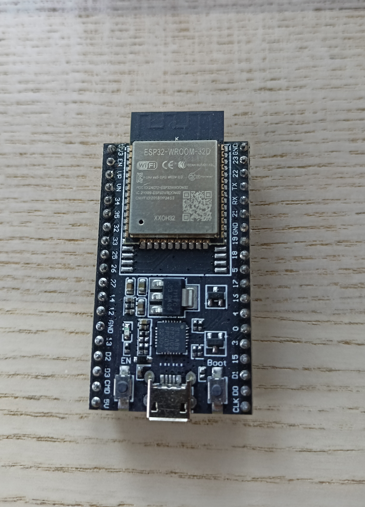
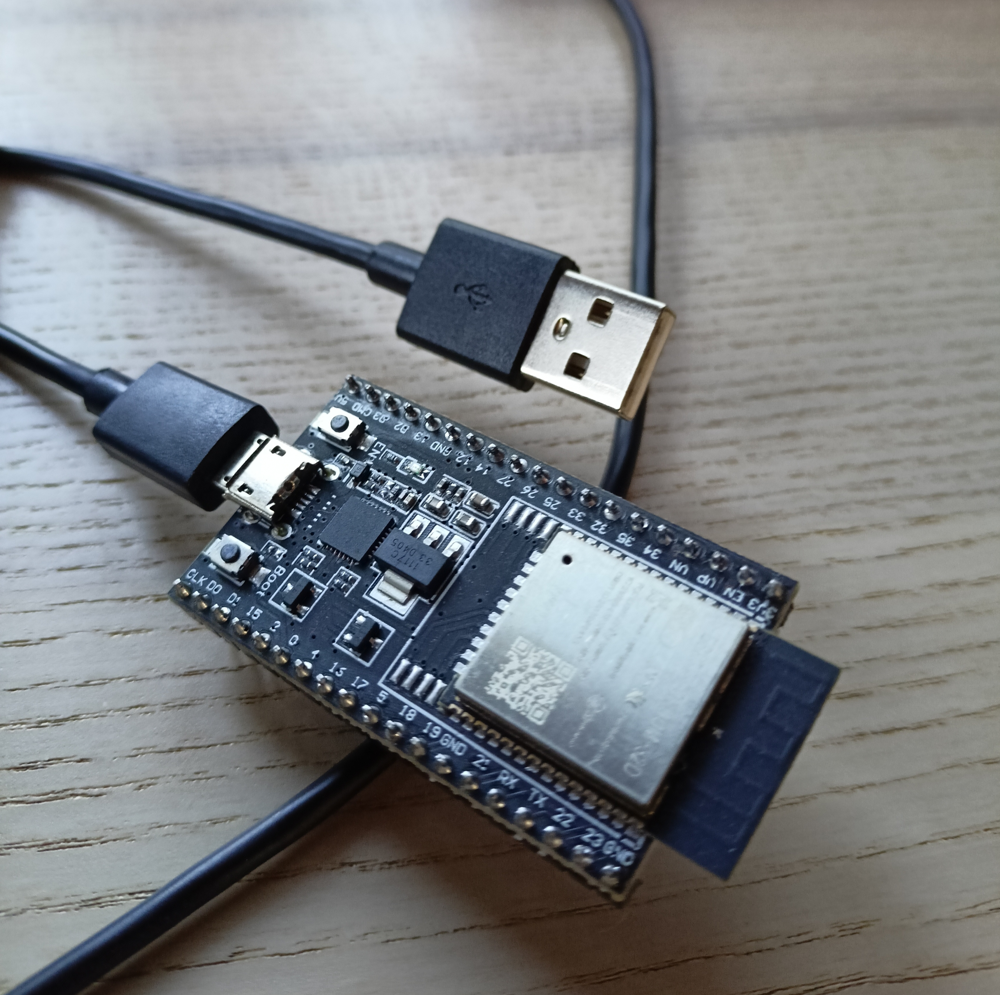
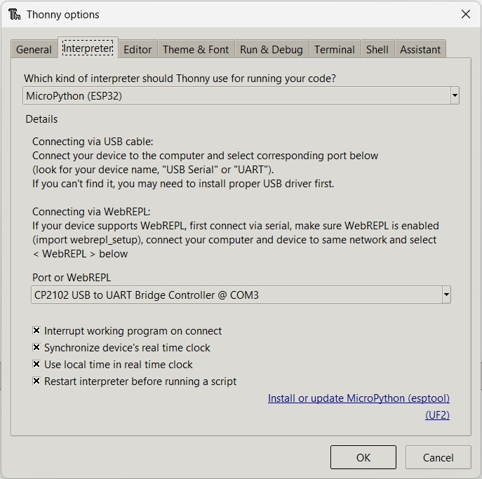
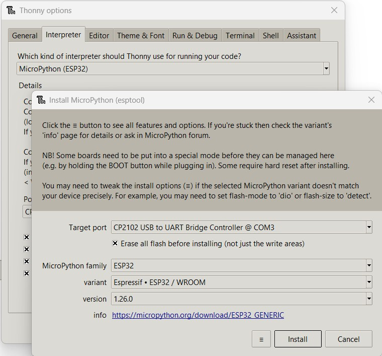
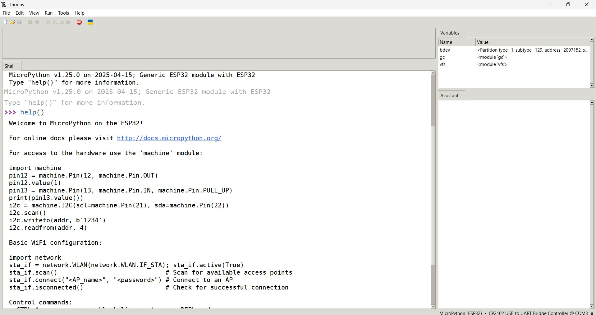

+++
title = "Ignition Sequence: How to Flash MicroPython onto Your ESP32"
description = "A step-by-step guide to flashing MicroPython firmware onto an ESP32, using either the Thonny IDE or the esptool terminal."
date = 2025-08-11
type = "article"
path = "ignition-sequence-how-to-flash-micropython-onto-your-esp32"

[extra]
image = "images/flash-micropython.jpg"

[taxonomies]
tags = ["python", "physical-computing", "tutorial"]
+++


We are going to breathe the soul of code to into its metal body - which means to bring your **ESP32 microcontroller** to life and open the door to the world of the **Internet of Things** (IoT), sensors, and robotics. The first critical step is uploading the **MicroPython** firmware, the "mission OS" that will allow you to command your hardware using the simple and powerful Python language.

One of ESP32 family of microcontrollers


There are two primary paths to achieve this. We’ll explore both:

* **Path A: The GUI Approach (via Thonny IDE)** - Perfect for beginners and rapid experiments.
* **Path B: The Engineer’s Approach (via Terminal)** - Gives you full control and is the standard for advanced projects and automation.
Let’s begin the pre-launch checklist.

## Step 1: Pre-Launch Checklist (Common for Both Paths)
Before we begin the main sequence, we need to prepare our equipment. These steps are necessary regardless of which path you choose later.

### 1. Download the MicroPython Firmware
Navigate to the official [Micropython archives](https://www.micropython.org/download/esp32/).

* Locate the latest stable version of the firmware (marked as "Stable") and download the .bin file.
* Save it to a directory where you can easily find it.

The exact type specification of a microcontroller can be seen etched onto metal cover:


### 2. Install USB-to-UART Bridge Drivers
For your computer to communicate with the ESP32, it needs the correct driver. Most ESP32 boards use a chip from Silicon Labs.

* Download the **CP210x USB to UART Bridge VCP Drivers** from the [Silicon Labs website](https://www.silabs.com/).
* Install the driver. It’s best to have your ESP32 connected to the computer during installation. 

*Note: On macOS and Linux, installation is often not necessary as the drivers are typically included.*

### 3. Prepare Your Ground Control Environment
This step ensures we have our tools ready in a clean, isolated environment. It’s a professional habit that will save you countless problems on future missions.

* Open your terminal (command prompt) in the folder where you downloaded the firmware.
* Create a virtual environment (think of it as a sterile laboratory for our project):

```bash
python -m venv venv
```

Activate it:
```bash
Windows: venv\Scripts\activate
macOS / Linux: source .venv/bin/activate
```
Install esptool, the essential utility for working with ESP chips:
```bash
pip install esptool
```
Checklist complete! All systems are go. 

We can now choose our launch method.

## Step 2: Choosing Your Launch Method
Select the method that best suits your mission profile.

ESP32 ready to be connected through a USB cable:


### Launch Method A: The Thonny IDE (The GUI Approach)
This method is ideal if you’re just starting or want to get firmware on the board as quickly as possible. A few clicks in a graphical interface is all it takes.

1. Open **Thonny IDE** (if you don’t have it, download it from [thonny.org](https://thonny.org/)).
2. Connect your ESP32 to your computer via USB.
3. In the menu, go to **Tools -> Options…** and open the **Interpreter tab**.
4. Select the **"MicroPython (ESP32)" interpreter**. For the **Port**, choose the one your ESP32 is connected to (e.g., COM3 on Windows or /dev/ttyUSB0 on Linux).
5. At the bottom right, click the button "Install or update firmware".
6. In the new window:
    * Double-check the Port.
    * In the **Firmware** field, click "Browse…" and select your downloaded .bin file.
    * Important: Check the option **"Erase flash before installing"**.
    * Click **"Install"**.

Thonny will handle the erasing and flashing process. Close the window when it’s done.

IDE Thonny - Tools - Options - Interpreter tab:


IDE Thonny - install / update MicroPython on ESP32:


✅ Method A Debriefing:
* **Who it’s for:** Beginners, for a quick and easy start.
* **Advantages:** Extremely simple, visual, everything in one tool.
* **Disadvantages:** Less control over the process, not suitable for automation.

### Launch Method B: The Terminal & esptool (The Engineer’s Approach)

This method gives you full control, is transparent, and allows for automation. It’s the standard used by experienced developers for any serious project. Run all commands in the terminal with your virtual environment activated.

### 1. Erase the Flash Memory
First, we’ll completely wipe the chip’s memory to ensure a clean install. Connect your ESP32 and run:

```bash
esptool.py --chip esp32 --port YOUR_PORT erase_flash
```
(Replace YOUR_PORT with your actual port, e.g., COM3)

### 2. Flash the Firmware
Now, we upload the downloaded .bin file:

```bash
esptool.py --chip esp32 --port YOUR_PORT --baud 460800 write_flash --verify 0x1000 FIRMWARE_FILE.bin
```

Mission Parameter Breakdown:
* --chip esp32: Explicitly tells the tool which chip we’re working with (good practice).
* --baud 460800: Sets a high transfer speed for faster flashing.
* write_flash: The command to upload.
* --verify: After uploading, checks that the data was written correctly. Highly recommended!
* 0x1000: The memory address where the firmware is flashed. This is the standard for ESP32.
* FIRMWARE_FILE.bin: The name of your downloaded firmware file.

*Pro Tip (The BOOT Button)*
Older procedures required holding the BOOT button during flashing. Modern boards and esptool can usually handle this automatically. Try running the commands without pressing any buttons first. If the upload fails, then use the classic method: hold BOOT, briefly press and release EN (or RST), then release BOOT.

✅ Method B Debriefing:
* **Who it’s for:** Advanced users, for automation, for anyone who wants full control.
* **Advantages:** Complete control, reliability, can be used in scripts for automation.
* **Disadvantages:** Requires working with the command line.

## Step 3: Systems Check & First Contact
Whichever path you chose, let’s now verify that all systems are operational.

Keep the ESP32 connected. In Thonny IDE, the bottom part (the Shell) should now show a MicroPython prompt:

```bash
MicroPython v1.2x.x on ESP32-D0WD-V3 Type "help()" for more information. 
>>>
```

Type "help()" at the >>> prompt and press Enter. You should see a welcome message from MicroPython.



Let’s try the "hardware Hello, World!" = blinking the onboard LED (usually on pin 2):

```python
import machine, time 

led = machine.Pin(2, machine.Pin.OUT) 

led.on() 
time.sleep(1) 
led.off()
```

If the LED on your board lit up for a second, congratulations! Your ESP32 is now a live, mission-ready vessel running MicroPython, prepared for your next command.