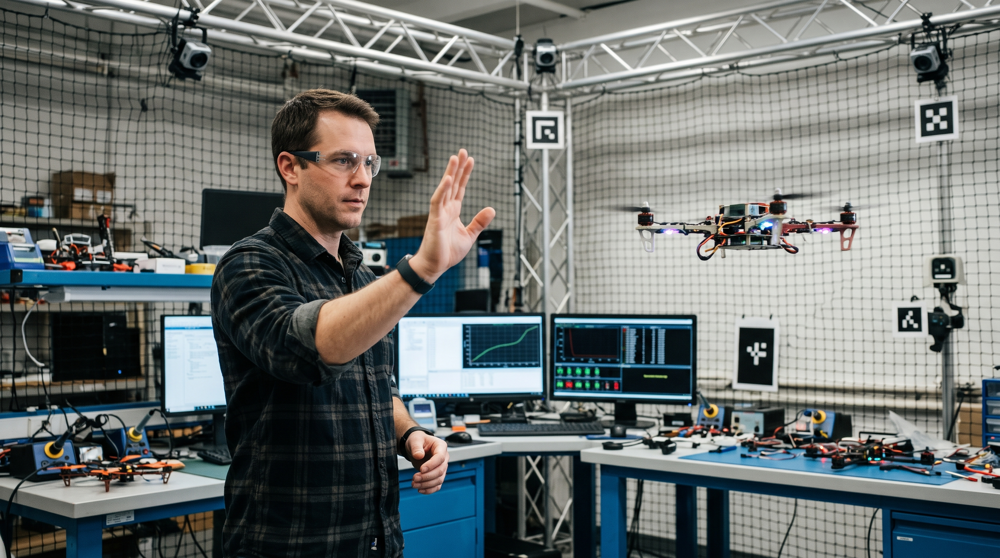
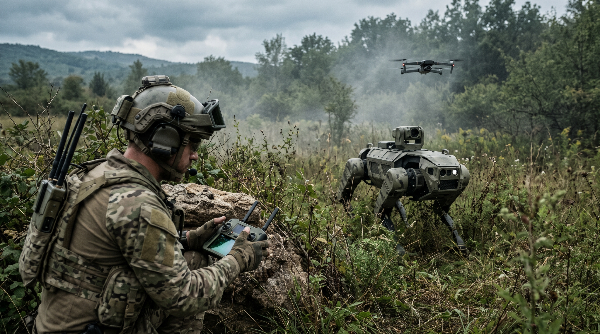

+++
title = "Basic Training is Over: The New Role of Developers in the AI War Room"
description = "How the developer's role shifts from writing code to directing AI, and why programming fundamentals still matter."
date = 2025-10-04
type = "article"
path = "basic-training-is-over-the-new-role-of-developers-in-the-ai-war-room"

[extra]
image = "images/general-ai-war-room.jpeg"

[taxonomies]
tags = ["ai-assisted-development", "software-design", "career-and-skills"]
+++

I’ve been actively using AI tools that came with ChatGPT since in 2022. Later, I started a practical experiment as a follow-up to my educational materials: the first of a three-part project building an app, starting with a terminal-based prototype in Python; then expand it with Flask and finally with Streamlit - links to all projects are listed at the end of the article. 

When I was building the first part of my project I laid out a clear and professional architecture: build it using **OOP**, adhere to **Single Responsibility** and **Separation of Concerns principles**, and ensure it’s modular.

*But instead of writing the code manually, I decided to delegate the implementation to an AI assistant to benchmark the process.*

I expected a time-saving, of course. What truly struck me, however, was the sheer quality and low error rate of the generated code. The AI didn’t just follow instructions; it understood the architectural principles. The time needed for verification was minimal. This wasn’t just another productivity boost; it felt like a fundamental leap in capability.

And that specific observation triggered a profound sense of professional vertigo. A project that would have represented a day or two of focused, skilled labor was completed well in the time it took to make coffee. It forced the hard questions that I believe every person in our field must now confront: 

*Was all the time I spent mastering Python loops, OOP principles, and software design a complete waste? What is the value of my (or any) GitHub portfolio if anyone can generate similar, or even better, projects in minutes? Is my hard-won skill now a commodity?*

* This is not the degradation of programming.
* This is its evolution, and it demands a radical shift in how we perceive our own value.

The invention of the excavator didn’t degrade the discipline of construction, but it absolutely commoditized the manual labor of digging holes with a shovel. AI is doing the same to the manual labor of writing code, *forcing us to operate at a higher level of abstraction*.

## The Drone Operator and the General
The initial fear comes from the assumption that a developer’s value lies in flawless execution of a given task. But I’ve realized there’s a profound difference between *operating an advanced weapon system and commanding a battlefield*.

An AI today is like a perfectly autonomous combat drone. A novice operator can be given a clear target (a simple idea), a rules-of-engagement checklist (a detailed prompt), and the drone will execute the mission (generate functional code) with lethal speed and precision. This capability is now accessible to almost anyone.

But the General - the expert - understands the **entire landscape**. They know the terrain, the enemy’s disposition, the political implications, and the long-term campaign objective. **The General’s job isn’t to fly the drone**; it’s to know if, when, and why to deploy it, and how that single tactical action fits into the overarching plan for winning the entire war. The operator executes a mission; the General achieves victory.

*The fear of becoming obsolete is valid only if we see our job as becoming a better drone operator. But our job, our true value, is evolving into that of the General.*

## The Three Tiers of Mission Command: Deconstructing "Describing the Problem"
The core counterargument is that "the ability to describe a problem" is now easy for anyone. This is a dangerous oversimplification. It only holds true for the most trivial class of problems. The reality of engineering is stratified into tiers of complexity:

### Tier I: Simple, Well-Defined Tasks (The Firing Order)
**Example:** "I need a script that takes data from this CSV, calculates the average of the third column, and saves the result to a text file."

Who can describe it? Almost anyone with a little effort-a manager, a client.

**AI Impact:** The fear of commoditization is valid here. This type of work is being fully commoditized. The market for basic "script writers" and junior coders focused on simple tasks will shrink dramatically.

### Tier II: Complex, Interconnected Systems (The Battle Plan)
**Example:** "We need an e-commerce platform: a product management system, customer accounts, payment gateway integration, real-time inventory, and a recommendation algorithm."

Who can describe it? A client can describe the goal, but they absolutely cannot describe the technical solution. For an AI to build this, it needs an expert to perform the immense "invisible work" before a single line of code is generated:

* **Decomposition:** Breaking the monolithic idea into dozens of smaller, logical, and independently generatable modules.
* **API & Data Contracts:** How will these modules communicate? What data structures will they pass between them?
* **Data Modeling:** What will the database schema look like? What are the relationships? An AI cannot magically deduce this from "I want an e-shop."
* **Non-Functional Requirements:** The client won’t say, "I need the system to scale to 10,000 concurrent users with a sub-100ms response time and be resilient to SQL injection." This is the expert’s job-to translate business needs into the precise technical language that an AI can execute.

**AI Impact:** Here, the AI acts as an extremely powerful team of junior developers. But it still requires a senior architect and technical leader to issue precise orders and verify their work.

### Tier III: Ambiguous, Innovative Problems (The Campaign Objective)
**Example:** "We want to disrupt the logistics market using AI and transportation data."

Who can describe it? No one, not clearly. The objective is a vague vision.

**AI Impact:** Here, the expert’s role evolves into that of a strategic partner and explorer. Their mission is:

* **Problem Finding:** To iterate with the client, using rapid prototyping with AI to find the right problem to solve.
* **Experimentation:** To create and discard dozens of prototypes at a fraction of the original time and cost.
* **Strategy:** To decide which technological paths are dead ends and which have real potential.

This role is more valuable than ever. The ability to rapidly materialize abstract ideas into functional prototypes is a superpower that AI grants to experts, not to novices.

Traditionally, a developer spent 80% of their time on implementation and debugging, and 20% on high-level, architectural thinking. That ratio is now inverting.

## The New Command Structure: From Soldier to General
Our career progression is no longer a simple ladder of technical proficiency; it’s a path of increasing strategic command. My military-style analogy of the "General vs. Soldier" helps to frame this shift. The value is moving away from the front-line execution and towards strategic command. Writing code is becoming the "basic training," essential for understanding the battlefield, but not the skill that wins the war.

**The Soldier:** The "Code Writer" This is the role of writing well-defined, standard code to execute a specific, given task. Soldiers are essential for their execution capabilities. This is the role that AI is now capable of performing with incredible speed and efficiency. The manual writing of boilerplate, standard functions, and common patterns is the new "basic training". This leads to a blunt and uncomfortable truth for those starting out:

*The traditional junior developer market, as we knew it, is dead. It’s not coming back.* 

The routine work that was once the proving ground for juniors is now the domain of AI. Companies are no longer looking for someone to simply write basic code under supervision. They are looking for a "new" entry-level professional who can delegate tasks to an AI, then critically verify, integrate, and take responsibility for the output. In essence, the skillset of this **"new junior"** is what we used to call a mid-level or even senior developer. This brings us to the next rank…

**The Sergeant:** The "Integrator & Quality Officer" This professional doesn’t just generate the code; they take the modules produced by AI "soldiers," rigorously test them against the specification, integrate them into a larger, coherent system, and ensure everything works together flawlessly. Their experience from "basic training" is crucial for spotting the subtle bugs, security flaws, and bad practices that an AI might produce. They are the non-commissioned officers who **turn the raw output of the soldiers into a functional unit**.

**The Colonel:** The "System Architect" This is the system designer. Their job is not to write the day-to-day code but to create the **battle plan**. They must deeply understand the business problem, deconstruct it into logical modules and tasks, define the precise APIs and data contracts, and create the unambiguous blueprints that the AI and the Sergeants will then execute. This is where the crucial intellectual "Shift-Left" occurs: the immense effort of strategic thinking and design moves to the very beginning of the process, because a flawed plan executed at the speed of AI leads to disaster with equal speed.

**The General:** The "Mission Strategist" The General understands the entire war. **They define the "why" behind the mission**, choose the overarching technological strategies, anticipate long-term problems, manage resources, and bear the **ultimate responsibility** for the success or failure of the entire operation. They don’t need to be the best shot in the army, but they must have come through the ranks to understand the reality on the ground.

## Why Basic Training is Non-Negotiable
This leads to a critical point. Why must a general go through the grueling basic training if they’ll never personally dig a trench in battle again? Because that experience builds irreplaceable skills:

**Credibility & Intuition:** How can you command soldiers if you’ve never felt the weight of the gear or the mud of the trenches? You cannot effectively architect systems or guide AI if you don’t have a deep, intuitive understanding of what happens "under the hood". The personal struggle with programming builds a technical intuition-a sixth sense for what is easy, what is hard, what is risky, and what is impossible.

**Qualified Estimation:** A leader with coding experience can better estimate the time, complexity, and potential pitfalls of a project. They won’t be fooled by an AI promising a magical solution to a fundamentally hard problem.

**Deep Debugging:** In the 5% of critical cases where a complex system fails and no one knows why, someone with a deep, fundamental understanding must step in. The General must be able to take the map, understand the terrain, and find a new route when the original plan fails.

**Better Command & Control (Prompting):** Because you understand the principles of communicating with a machine, your "orders" (prompts) to the AI will be an order of magnitude more precise and effective, leading to better results with fewer costly iterations.

## The Modern Engineer’s Manifesto
My GitHub portfolio, filled with AI-assisted projects, no longer says, "Look how well I can type code." It now sends a different message: "Look how well I can define a problem, design a system, direct advanced tools, and deliver a result."

* My value is not in my fingers on the keyboard, but in my mind
* I need to free my hands to free my mind to design systems
* I am a man-architect, not a typewriter!

We learn to program deeply not so we can spend our lives in the trenches writing "for" loops, but to earn the freedom not to. We master the fundamentals to gain the authority, intuition, and capability to focus on strategy, to lead, and to architect.

---

*And that is the new, true role of an engineer in the AI war room.*

➡️ Get inspired:

* [Python (Prototype) Project](https://github.com/GeorgeFreedomTech/Terminal-Commander)

* [Flask (Web App) Project](https://github.com/GeorgeFreedomTech/Flask-Mission-Control)

* [Streamlit (Data Science & Visualization) Project](https://github.com/GeorgeFreedomTech/Peru-Regional-Telemetry)