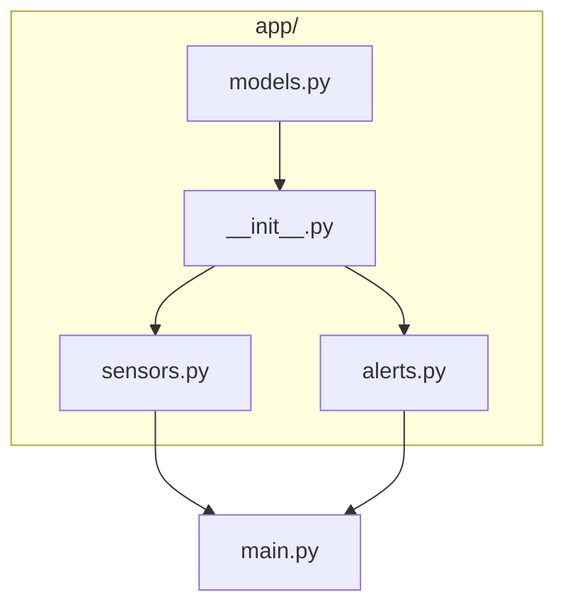

+++
title = "The Modern Architect's Playbook: A Guide to AI-Assisted Development"
description = "A practical method for AI-assisted development: design the architecture first, then split roles between planning LLMs and an in-editor assistant."
date = 2025-10-16
type = "article"
path = "the-modern-architects-playbook-a-guide-to-ai-assisted-development"

[extra]
image = "images/modern-architect-playbook.jpeg"

[taxonomies]
tags = ["ai-assisted-development", "software-design", "tutorial"]
+++


## Intro
In the new era of software development, simply using AI tools isn’t enough. Without a clear methodology, we risk creating chaos faster than ever before. True efficiency comes from a disciplined, architectural approach where the human guides and the AI executes.

This is the playbook for that process - a practical guide for the **modern systems architect**, framed as the training protocol for the next generation of space explorers.

*Note: I am using Python in my examples but principles and structure presented work for any programming language.*

## Mission Profile
Throughout this playbook we’ll design **Station Monitor** - a tiny Python tool that reads sensors on a space station and warns when a value leaves its safe limits.

It is intentionally simple. The project is only a vehicle for demonstrating the method - what matters is the approach, not the application.

## Phase 1: The Simulator Blueprint
Before any astronaut trains for a lunar mission, the flight directors and engineers must first design the simulator itself. Every scenario, every system, every potential failure must be architected before a trainee even steps into the cockpit. This is the Blueprint Phase - the most critical part of the entire operation, where we think, then act.

The process is methodical:

* **Mission Visualization (Top-Down Mindset):** First, the entire mission is visualized. We create the architectural plan, defining all systems and their interactions. For this, tools like **Mermaid** are invaluable for creating the clear, version-controlled schematics that serve as our master plan.



Notice the shape of the plan: we go down to the foundation first, then spread wide across independent modules, and only then bring everything together. We will come back to this shape later.

* **Staging the Environment:** Once the plan is solid, we prepare the "training facility" - the project’s directory structure. We create all the necessary files and folders, laying out a clean and logical foundation for the simulation’s code.

```text
station-monitor
├── README.md
├── main.py
└── app/
    ├── __init__.py
    ├── models.py
    ├── sensors.py
    └── alerts.py
```

* **Issuing the Directives:** Inside this empty structure, we write docstrings. These are not just comments; they are the mission parameters and operational objectives for both ourselves and our AI assistants. They define the purpose and responsibility of each module before implementation begins.

```python
"""
MISSION BRIEFING: Alerts (app/alerts.py)

Decides whether a sensor reading is safe and creates an alert if it is not (Step 3).
It uses `Reading` and `Alert` from `models.py`.
It does NOT read sensors - that is the job of `sensors.py`.

AI INSTRUCTIONS (For the Tactical AI / Flight Engineer):
1. One function, one job. Keep functions short.
2. Never print anything here. Only return results.
3. Safe limits are defined once, at the top of this file. Never hardcode numbers elsewhere.
4. If you need data from `sensors.py`, do not import it here -
   suggest a change in `main.py` instead.
"""

# TODO (AI): Write a function that checks a single reading.
# - Reading within safe limits -> no alert
# - Reading close to a limit -> WARNING alert
# - Reading outside the limits -> CRITICAL alert
# - Unknown sensor -> clear, understandable error message
```

Notice the difference between the two parts. The docstring contains standing orders - they apply to everything we (or the AI) will ever write in this file. The `TODO` is a one-time command for the task at hand.

This is the process that separates reactive coding from deliberate engineering.

## Phase 2: Assembling Your AI Training Staff
A modern flight simulator doesn’t run on its own; it’s managed by a sophisticated staff. To maximize efficiency, we must assign clear roles to our AI assistants, reflecting a strict separation of concerns.

### The Strategic AI (The Mission Planner LLMs - e.g., Gemini, ChatGPT, etc.): 
I use this AI for high-level, architectural tasks. Think of it as the lead engineer who helps design the entire training program. Based on my vision, it generates the complete, empty, but fully documented project skeleton. It helps flesh out the initial blueprint and strategic documentation (e.g. README.md, high-level docstrings). *Its role is planning and structure. Here is where I dream, create and evolve the bigger picture.*

### The Tactical AI (The Cockpit Instructor - e.g., GitHub Copilot): 
This is my on-the-ground implementation assistant. Working inside my IDE, it’s the instructor sitting next to the trainee. It takes my specific, short commands (in the form of comments like # Initiate pre-flight check) and generates the actual code to execute that maneuver. *Its role is execution and real-time assistance. This is my workbench where I can focus on details and "get job done".*

If the simulation reveals a major flaw in the mission plan, I return to my Strategic AI to discuss adjustments to the overall architectural blueprint.

## Understanding Your Cockpit Instructor’s Intel
To get the most out of your Tactical AI (IDE plugin), you must understand how it gathers intelligence (context). It’s not magic; it’s an operative with three layers of awareness within the simulator:

### 1. The Active Control Panel (The Active File): 
This is its most critical source of information. The AI analyzes everything **on the screen** you’re currently working on: the code above and below your cursor, import statements, class and function definitions, and - most importantly - your docstrings and comments.

### 2. Adjacent Systems (Open Tabs): 
The AI maintains a short-term memory of other control panels you have open. It correctly assumes that if `alerts.py` and `models.py` are open simultaneously, they are part of the same system and **will use context** from both of them. In practice: when you work on a module, keep open the files it depends on.

### 3. The Full Spacecraft Schematic (The Entire Project): 
This is where it gets powerful. Depending on the tool and its mode, the AI can **look beyond your open files** and draw on the wider project, following import statements and function calls to find relevant definitions. High-level documents like `README.md` or the main docstring in `app/__init__.py` serve as its "mission briefing", giving it the strategic overview it needs to make better tactical suggestions.

*In short: prepare your project as if you were onboarding a new flight engineer. The clearer your documentation and structure, the more intelligently your AI assistant will perform.*

```text
README.md

# 🚀 Station Monitor

**Mission Objective:** Read station sensors and warn when a value leaves its safe limits.

## 🏗️ Architecture Blueprint
Build in this order - each step relies only on the previous ones:
1. `app/models.py` - data structures
2. `app/__init__.py` - package briefing, the place where parts are connected
3. `app/sensors.py` and `app/alerts.py` - one module at a time
4. `main.py` - entry point, connects everything
5. Refine - tidy up, remove duplication, update this file

## 🤖 AI Directives
* **Strategic AI (Planner):** Treat this document as the master schematic.
  If a new file is needed, propose an update to this blueprint first.
* **Tactical AI (IDE Copilot):** Use this file for global context.
  Do not suggest new files or architectural changes.
  Follow the instructions at the top of each file.
```

```python
"""
MISSION BRIEFING: The `app` Package (app/__init__.py)

The central assembly of the project (Step 2). It gathers the building blocks
from `models.py`, `sensors.py` and `alerts.py` in one place, so that `main.py`
can use them with a single import from `app`.

AI INSTRUCTIONS (For the Tactical AI / Flight Engineer):
1. STRICT RULE: No logic in this file. Only connect the parts.
2. Expose only what `main.py` needs - nothing else.
3. Do not add new files or folders. Follow the structure described in README.md.
"""
```

## The Build Sequence: Constructing the Simulator
How do we actually build our app? We can’t start our mission simulator with the flashy graphics on the main viewscreen. We must begin with the core physics engine and the data models that define the spacecraft itself. This requires a **bottom-up** approach (from data to the package assembly) followed by a **lateral movement** (between modules) to ensure a stable and logical foundation.

Here is a battle-tested sequence for building Station Monitor:

* **Step 1: The Core Components (Data Models) 🏛️** We start down at the bottom by defining the fundamental components of our simulated world. In `app/models.py`, we define our data structures - what a sensor reading is and what an alert is. Data is the foundation of everything; defining it first prevents countless future system failures.

```python
"""
MISSION BRIEFING: Data Models (app/models.py)

Defines the basic building blocks of the whole project (Step 1).
Nothing else in the project may define its own data structures.

AI INSTRUCTIONS (For the Tactical AI / Flight Engineer):
1. Keep it simple - plain data only, no logic, no printing.
2. Use clear, descriptive names (e.g. sensor_name, value, unit).
3. Every other file imports from here. Never import anything into this file.
"""

# TODO (AI): Define two simple data structures:
# - Reading: which sensor, measured value, unit
# - Alert: which sensor, how serious (WARNING or CRITICAL), the value that caused it
```

* **Step 2: The Mainframe Assembly (Package Assembly) 🏗️** Next, we move upward to `app/__init__.py`. This is the assembly line of our package: it gathers the building blocks in one place, so the rest of the project can use them with a single import from `app`. At this point the modules are still empty - we only prepare the place where they will be connected. *(In a larger web project, e.g. in Flask, this is where the application factory lives.)*

* **Step 3: Support Systems (Functional Modules: Sensors & Alerts) 🔑** With the mainframe ready, we can start moving laterally - we build the first complete, testable "slice" of functionality: `app/sensors.py`, the module that provides the readings. This provides a crucial early win and a solid foundation for all subsequent modules. After we finish the first module - continue with the next one: `app/alerts.py`. Notice that these modules know nothing about each other. Connecting them is not their job.

* **Step 4: Executing the Core Mission (Main Application Logic) 🚀** Now that all systems (modules) are ready, we can build the core mission in `main.py`. This is the only file we run directly, and it simply connects the modules into a working program - building upon the solid foundation established in the previous steps.

```python
"""
MISSION BRIEFING: Entry Point (main.py)

The only file that is run directly (Step 4). It uses everything
through the `app` package - never import from the files inside `app/` directly.

AI INSTRUCTIONS (For the Tactical AI / Flight Engineer):
1. This file only connects things. No safety rules, no measurement logic.
2. All printing to the screen happens here and nowhere else.
3. Keep it readable from top to bottom, like a checklist.
"""

# TODO (AI): Get readings from sensors, check each one, print a short status line per sensor.
# - Print a clear message if everything is OK.
# - Highlight WARNING and CRITICAL alerts so they stand out.
```

* **Step 5: Systems Integration & Refinement (Cleanup) ✨** As a final step, we "clean up" and polish the cockpit. Now that we have multiple functional modules, we can identify common or repeating elements and move each of them to one single place. This ensures consistency and makes future modifications vastly more efficient. Finally, we update the README so that the blueprint matches reality. *(In a web app, this is the moment when a shared `base.html` template is born.)*

This **T-shape strategy** - going bottom-up (from data to package assembly) first combined with lateral (module-by-module) approach afterwards is a logical and stable methodology for architecting robust systems with an AI assistant, ensuring your final spacecraft is mission-ready.

## Conclusion: The Architect’s Mandate
This playbook is more than just a set of instructions; it’s a new operational doctrine. It defines a strategic shift where the developer’s primary value is no longer in the manual labor of implementation, but in the intellectual rigor of architecture, system design, and quality assurance. The AI is a powerful engine, but the human is the mission director - the one who charts the course, understands the objective, and bears the ultimate responsibility for success.

-

*This methodology isn’t about working less; it’s about working on what truly matters. Welcome to Mission Control.*

➡️ Get inspired:

* [Python project](https://github.com/GeorgeFreedomTech/Terminal-Commander)

* [Flask project](https://github.com/GeorgeFreedomTech/Flask-Mission-Control)

* [Streamlit project](https://github.com/GeorgeFreedomTech/Peru-Regional-Telemetry)